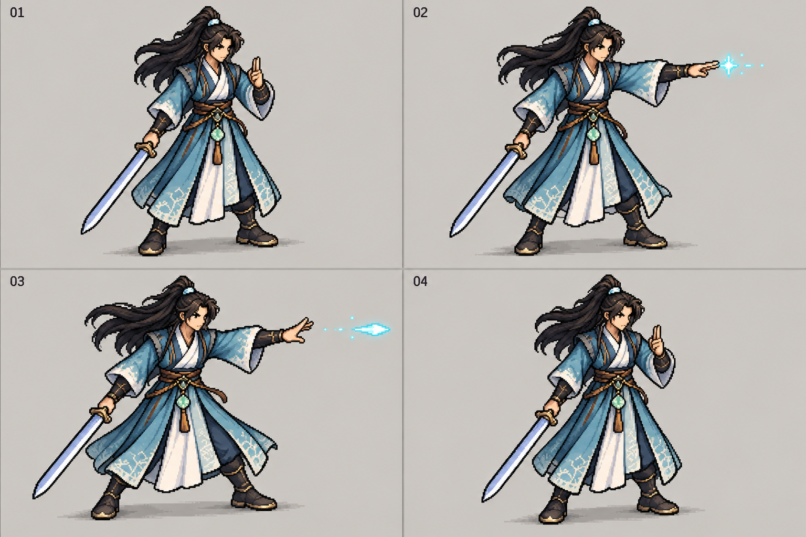
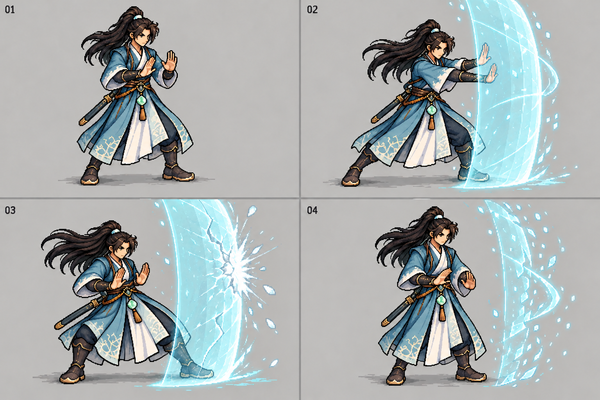
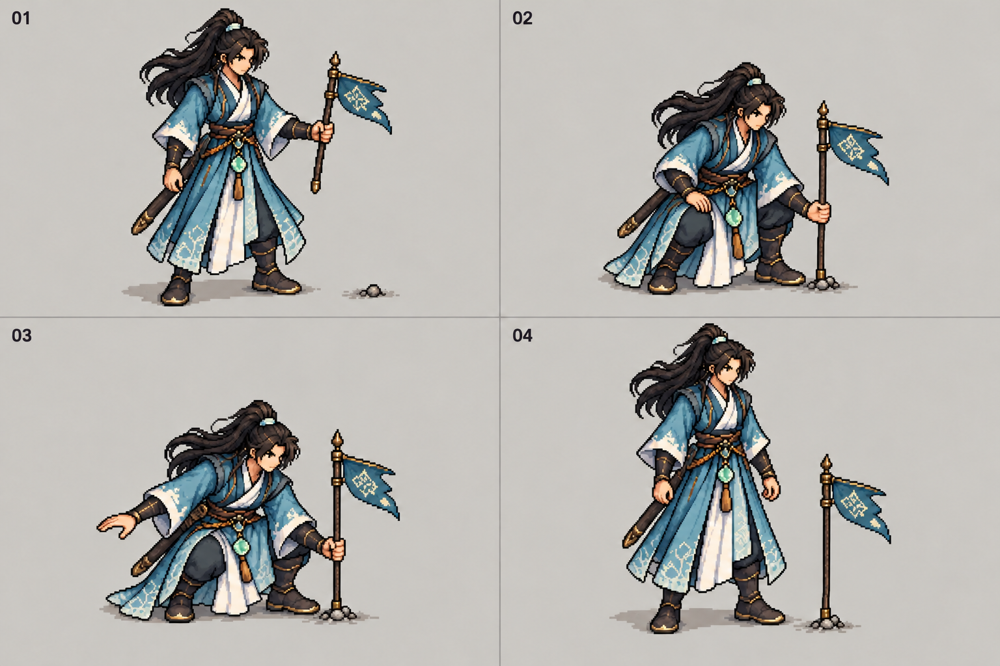
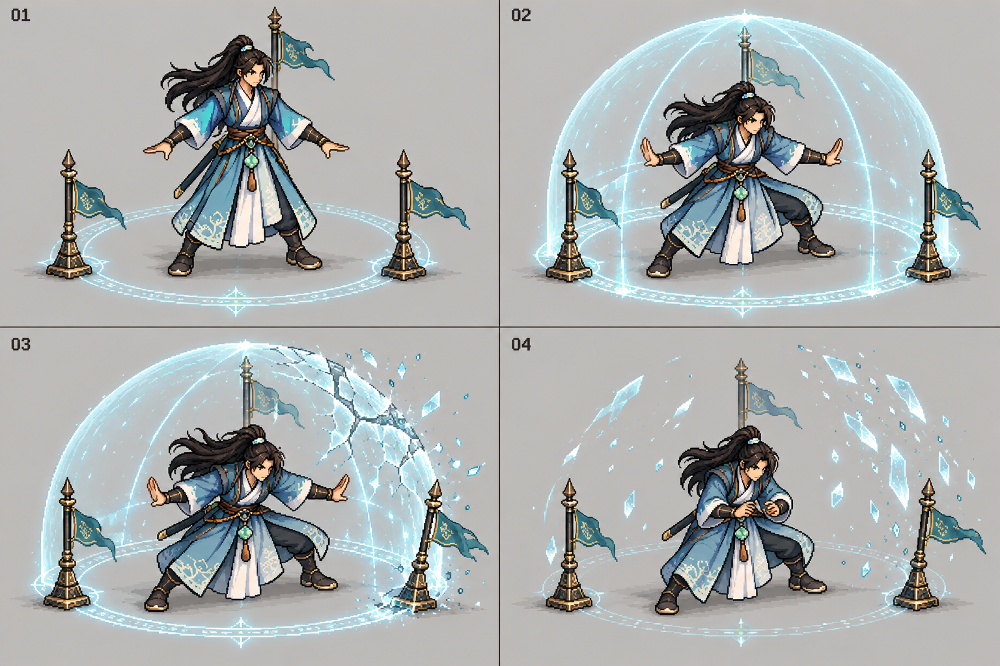
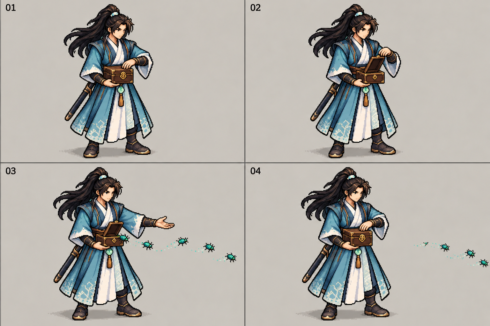
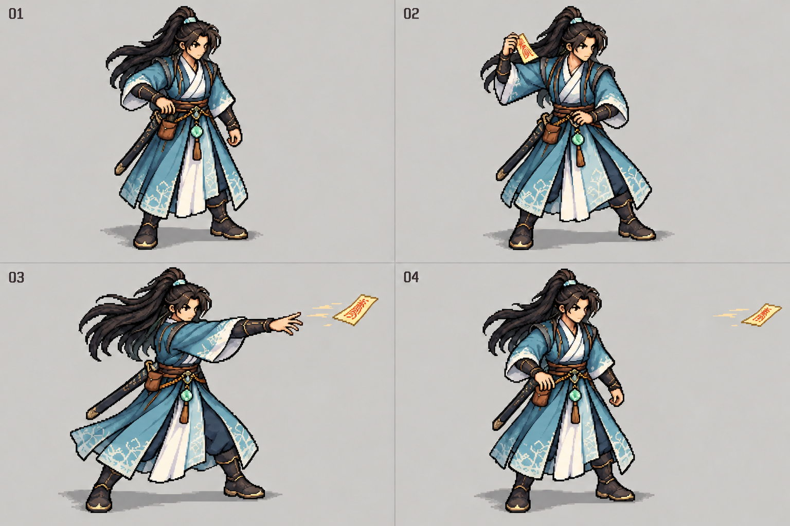
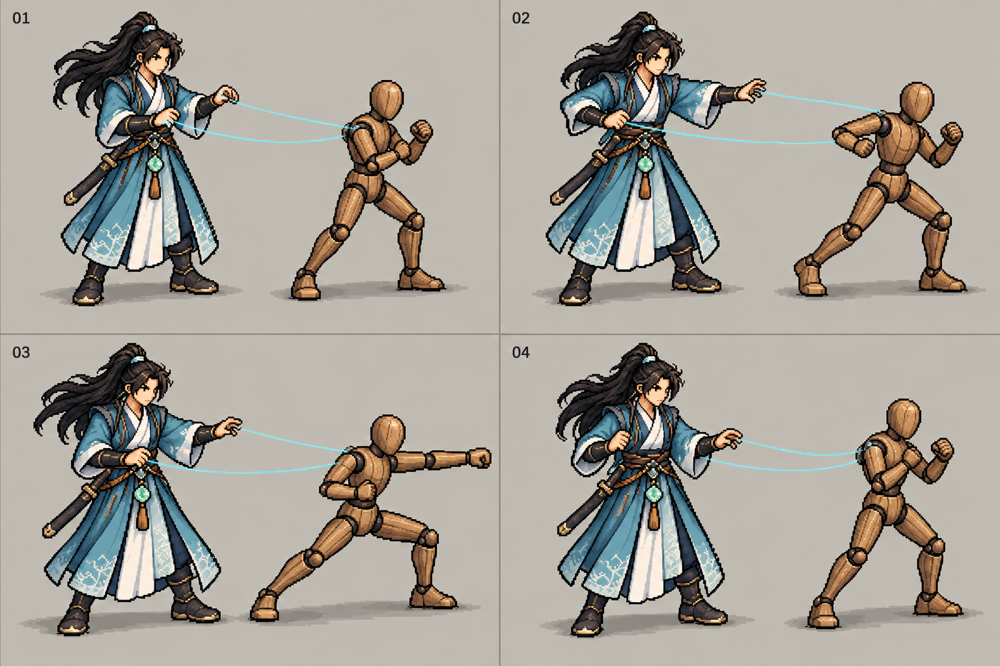

# 沈砚首批动作关键姿势

2026-10-17。按 U-159 制作七组动作的关键姿势，每组四格，共 28 个姿势。沿用原蓝白袍、长发与佩剑形象，固定右前侧机位。图片供评看动作意图、承力姿势和持物关系；连续动画需进一步拆层、补帧与对齐。

外观依据为[原像素人物](../../../assets/characters/shen-yan/pixel-walk-study-v1/source/pixel-identity-reference.png)，动作依据为[55 人物动作库](../../design/55-CHARACTER-ACTION-LIBRARY.md)。以下左右手均指人物自身；图片按左上、右上、左下、右下阅读。

## 引诀点发 S01

右手持剑，左手引诀。四格依次为收诀、送臂、离手释放、回收。剑保持在身体外侧，指尖与释放物分开显示。

## 双掌护持 S04

剑已入鞘，两手空掌。四格依次为沉肩蓄势、前推立障、屈肘后坐承击、收掌散障。前方护障高过头顶、下接地面；承击时后腿承重，身体姿势交代压力。

## 部署阵旗 A02

左手持同一面阵旗，右手扶膝或平衡。四格依次为持旗认位、俯身插旗、压实检视、松手起身。阵旗放下后留在地面，剑全程在鞘。

## 撑阵 A04

三处已部署节点围住持阵位，双手向两侧展开。四格依次为入势、稳撑、阵面受压开裂、破阵后收腕缓冲。人物位于穹顶之内，地面节点、阵面和身体共同显示受压。

## 开匣放蛊 G01

右手始终托住蛊匣，左手负责启盖、引蛊和合盖。四格依次为扶盖、启盖、低送放蛊、合盖。虫群从匣口离开；合盖后已放出的蛊继续在外。持续控蛊姿势在后续动画段接续。

## 拈符掷放 F01

右手从腰囊取出一张符，举至肩侧后转肩掷出。四格依次为取符、拈符蓄势、离手、回正。剑保持在鞘，符囊始终挂在原腰位。

## 控偶进攻 P03

人物留在后侧，左腕前送、右腕内牵；木偶单独完成前方攻击。四格依次为待令、进步、送拳、回防。两条细线表达操控关系，后续随实际操控媒介制作。

## 制作与核对

七张 PNG 均为 1536×1024，使用内置 `image_gen.imagegen` 生成并逐张评看；原图来源、完整生成及修整提示词、参考图和文件散列见 [prompts.json](prompts.json)。已核对七组的动作轮廓、双手占用、剑的持握或收鞘、实物去向与四格顺序，独立复核见 [review.json](review.json)。最终美术效果待用户评看。

进入连续动画制作时，需要统一人物尺寸、脚底锚点、衣纹和配饰位置，拆出透明人物及道具层，补齐起势、接触、释放和回收之间的过渡。P03 第四格下方控制线的手腕起点需进一步明确；111 像素常规尺寸下的手势、虫群和符纸辨识需随动画样片复看。图中阵旗与护阵节点是各自的道具设计草图，成品需按实际器材统一尺寸和结构。

本批对应 SR-XF-007 的人物活动表现与 SR-XF-013 的攻守表现设计。运行中的正常执行、受阻、中断、存读和目标设备验证在接入后进行；完整 SR/AC 状态保持。
