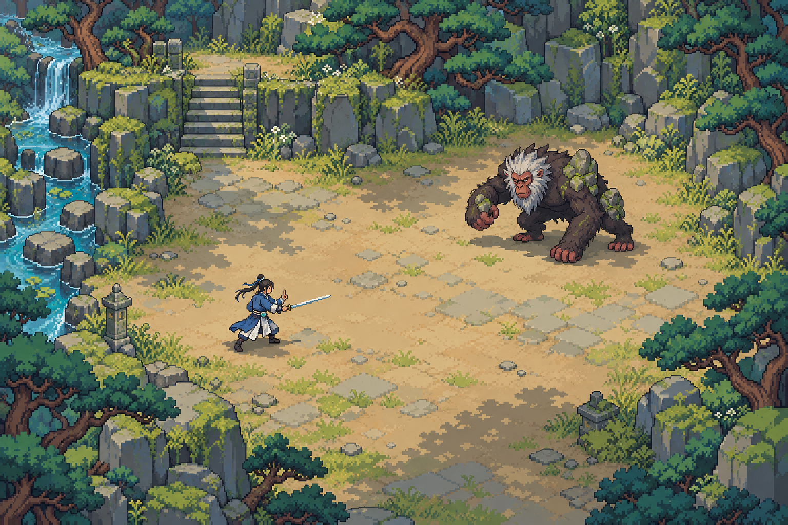
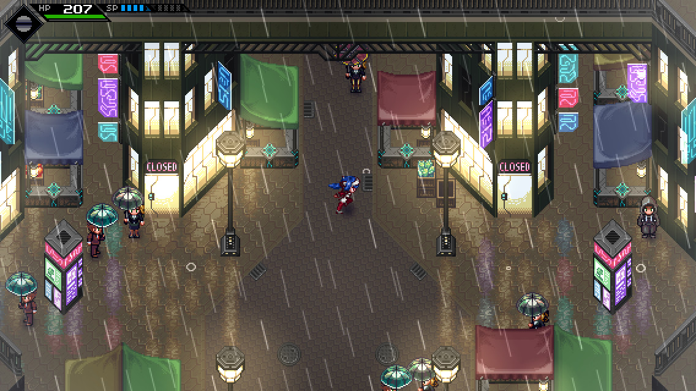
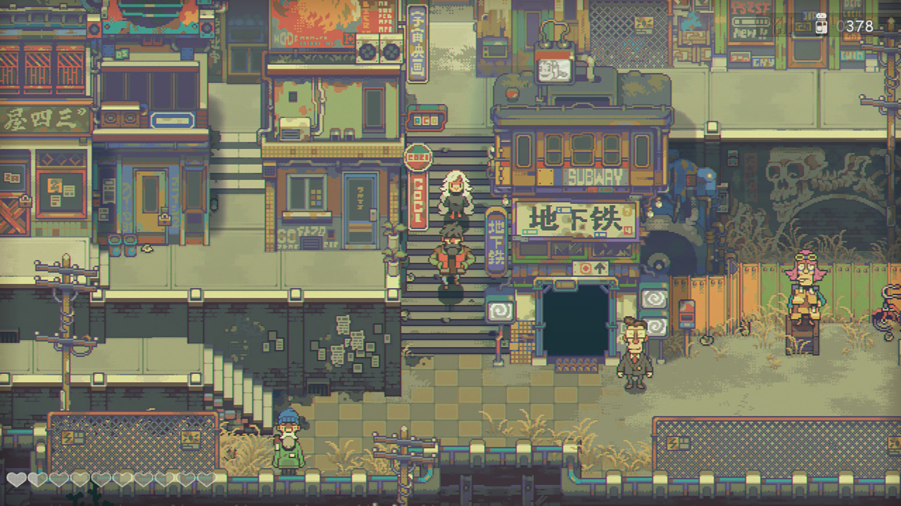

# 林间剑修与山魈战场美术样图

2026-10-25。本批交付一张完整静态战场美术样图，用于评看剑修、山魈、林地构图和像素表现。主Agent逐次查看三轮结果并展示第三稿后，用户回复“看起来不错”“可以”，认可整体方向并授权先校准尺度、再制作完整帧动画。该认可不覆盖新比例、动作或实机验收；后续实际结果见[同网格与动作研究](../combat-motion-study-20261025/README.md)。

原图 1536×1024，由内置 `image_gen` 生成，原样复制到本目录，未作后期缩放、滤镜或拼贴。SHA-256：`db2d4dd634e005cd7ec4a2620fd1e6311b3559011a6642b755aa7b4de6e34d2e`。

## 网站来源与适用范围

本次重新访问 [Game Art Style 首页](https://gameartstyle.loopyhop.com/)和[俯视瓦片像素页](https://gameartstyle.loopyhop.com/styles/topdown-tile-pixel/)，读取实际提示词并查看该页三张具体截图。保存的[当次网页原文](references/source-page.html)包含该页完整原始 prompt。读取的是网站原文，不以历史摘要代替。

页面提供的是覆盖角色、环境、物件、界面、特效和动画的全局美术指导，不是一个现成的森林场景、单角色或整幅战斗图生成配方。其空间规则包括俯视地面、可见立面、直立角色、遮挡与高差；比例、像素密度和色阶要共同约束。场景题材仍需按项目具体改写。

本图把这些规则落实为同一镜头中的两名战斗主体、岩阶林缘和开阔空地；用户已认可整体美术方向，具体人物尺度、统一像素密度与运行参数仍须分别校准和验证。

| 实际查看的参考 | 对本图的具体作用 | 本图仍有的差异 |
| --- | --- | --- |
| CrossCode 雨夜街道 | 观察地面与直立角色、建筑立面与前后遮挡怎样共同建立空间；修订时作为直接图像参考 | 本图环境与兽体的细节更密，尚未得到严格统一的整数像素网格 |
| Eastward 台阶街区 | 观察台阶、前景物件和大块明暗如何组织高差与画面层次；修订时作为直接图像参考 | 本图采用明亮林间环境，人物比例也未照搬其角色头身比 |
| Stardew Valley 林地与道路 | 观察草地到道路的边界、成组树木和地面尺度；仅人工阅读参考 | 本图中央用土石空地和较低纹理密度服务远程交锋 |

| CrossCode 原网页样例 | Eastward 原网页样例 |
| --- | --- |
|  |  |

[Stardew Valley 原网页样例](references/stardew-valley.jpg)。三张参考保留原始下载字节，仅作本地视觉研究和对照；权利归各自权利人，未选作运行素材。

## 修仙题材改写与实际 prompt

沿用沈砚已有外观识别项：黑发束髻、蓝白衣装、右手持直剑、玉佩与深色靴；参考[原像素人物来源](../../../assets/characters/shen-yan/pixel-walk-study-v1/README.md)。当前绘制是该身份的像素概括候选，不能把旧人物认可自动传递给此图的新比例。

山魈以长臂灵长类轮廓、朱面灰鬃、厚重指节和少量苔岩肩甲组织辨识。中央土石空地承载远程交锋，边缘由松林、岩壁、溪流和台阶构成层次。所有制作词均按实际调用保存：

| 轮次 | 实际 prompt 与输入 | 主 Agent 实际审图结论 |
| --- | --- | --- |
| 1 | [prompt-v1.txt](prompt-v1.txt)；以网站全局指导为文字起点，加入具体修仙人物、异兽、构图和像素预算；本次调用无图像输入 | 人物和山魈的设计与场景关系可辨，但明显偏绘画质感，角色过大；继续修订 |
| 2 | [prompt-v2.txt](prompt-v2.txt)；输入第一稿、CrossCode 与 Eastward 的本地参考图 | 地面留白改善，但树石的粗颗粒与角色细线密度不一致；继续修订 |
| 3 | [prompt-v3.txt](prompt-v3.txt)；仅输入网站的 CrossCode 与 Eastward 参考图，重新组织整图的像素表现 | 选作本批展示图。剑修和山魈轮廓、空地、林缘和岩阶关系能同时评看；精确尺度和像素网格仍待定 |

本图共三次生成，原稿与prompt保留。用户随后已授权校准尺度与帧动画制作；实际动作美术及运行接入分别验收。

## 视觉检查与待定项

主 Agent 已查看三轮实际图像，以及最终工作区原图。第三稿有一名蓝白衣装持剑人物和一只长臂朱面山魈；双方身体、脚点和相对方向可见，中央没有树木挡住交锋线。后侧岩壁前脸、台阶和林缘遮挡构成高差，左侧溪流与主要空地区分。

仍需明确：

- 提示词要求按约22米宽镜头绘制，第三稿中的人物实际高度仍大于所写108像素预算。此图只表达开阔构图，不能作22米视野与人物米制尺寸精确对齐的证明；48×32米战场、22米宽跟随镜头的运行要求保持。
- 人物轮廓与环境比前两稿更接近同一种像素表现，但植被、兽鬃仍含较细颗粒；生成图未通过逐像素整数网格、色阶或可平铺瓦片验证。
- 此图是静态画面，不证明动画连续性、右手在全部方向的一致性、命中反馈、受击僵直、响应或整屏帧率，也不提供可直接用于运行的分层与碰撞数据。

## 本批范围与证据

| 关联需求 | 当前依据 | 本批交付与验证边界 |
| --- | --- | --- |
| SR-XF-003 AC01/02、SR-XF-029 界面呈现 | 用户2026-10-25本次明确指令、46统一尺度及网站原始指导 | 一张完整静态构图，主 Agent 视觉查看；导航、输入、真实碰撞与界面未运行 |
| SR-XF-007 AC01/02/03 | 同一沈砚身份、55动作库、用户本次人物与异兽设计要求 | 静态辨识候选；未生成动作库，不推进完整人物AC |
| SR-XF-013战斗 | 用户已经确定的实时战斗、鼠标定向、短停施法和远程走位要求 | 构图保留交锋与走位空间；未执行战斗或性能验证，不推进战斗AC |

新增本目录的图像、提示词和参考记录；记录性更新由[73制作记录](../../design/73-COMBAT-FRAME-PRODUCTION.md)、台账和接手导航接续。没有本批运行代码修改或存档操作，正常、失败与存读测试不适用于这张静态图；保留原有对应验收状态。当前已有美术包与运行引用保留可恢复，用户对原成品的最终决定以73最新段为准。

## 来源文件

- [来源与散列](sources.json)：页面、官方截图地址、下载副本、图像输入角色及生成源文件。
- [最终样图](battlefield-study.png)：第三次调用输出。
- [第一稿实际提示词](prompt-v1.txt)、[第二稿实际提示词](prompt-v2.txt)、[第三稿实际提示词](prompt-v3.txt)。

生成原件均保留在 `/Users/shepard/.codex/generated_images/01a171b0-eee9-7701-bd4a-61dcb2b0b53b/`，前两稿仅作本批迭代记录，不作为运行素材。
