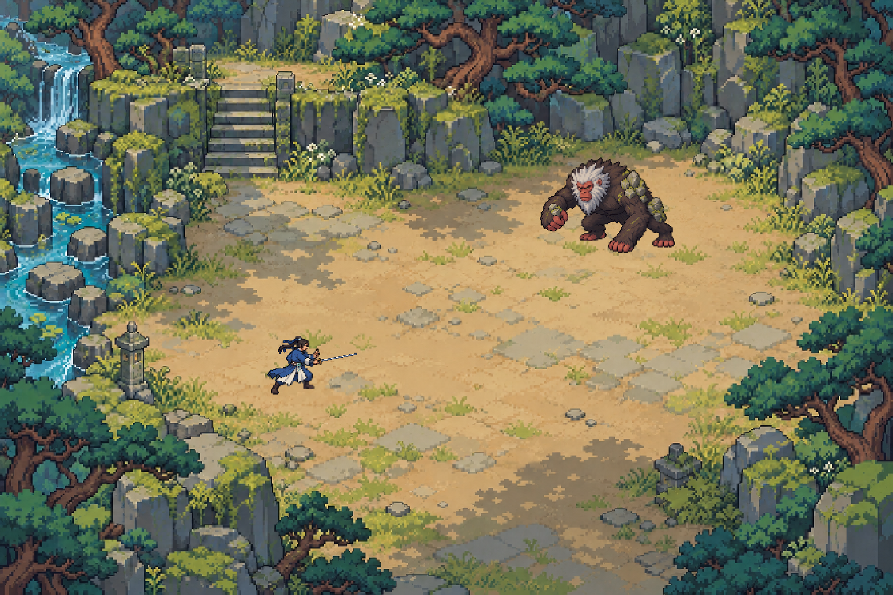

# 战场同网格校准与跑步帧研究

2026-10-25。用户对[完整战场样图](../combat-field-study-20261025/README.md)回复“看起来不错”“可以”，随后对同标尺场景再次回复“可以，看着不错”并要求继续；已认可两者整体观感，动作库、精确像素规则和实机验收仍分别进行。本批保持离线，未改运行代码、运行素材registry或存档。

## 静态校准

主Agent已亲自查看下图及接触表，用户已认可同标尺整体观感。人物落地阴影仍缺，草木纹理粒度也未证明所有素材原生像素密度一致。



作者候选为40逻辑像素/米：22米视图宽880逻辑像素，1.45米人物标尺58像素。两只角色统一使用`58/414`，不按各自包围框缩放；背景按同网格nearest处理，再将整幅统一nearest放大至1536×1024。理论身体标尺101.236px，整数参考101px的误差−0.236px；实际alpha≥8外包框高为人101px、兽164px，这些包围框不重定义解剖身高。背景逻辑高586.667→587，误差+0.333逻辑像素，最终底边裁去0.582屏幕像素；脚点舍入误差均小于1屏幕像素。

[接触表](calibration/common-grid-v001/contact-sheet.png)、[完整参数与来源散列](calibration/common-grid-v001/calibration.json)、[取整误差](calibration/common-grid-v001/measurement-summary.json)随图保留。原[角色母图](source/character-masters.png)与[无人背景](source/clearing-plate.png)字节保持；人物裁切没有切到主体或剑尖，裁外49个alpha=1尘点单列，未做阈值清理。处理只含裁切、统一nearest、整帧平移和合成，不证明正式空间、碰撞或像素风一致性验收。

## 单方向八帧循环候选 · 55 B02

[v6右支撑四帧](source/run-right-support-v6.png)接[v5左支撑四帧](source/run-left-support-v5.png)，统一H0=500、`58/500`nearest，8×60ms=480ms为作者候选节拍。原图实测1254×1254；按x615分两列、y627分两行，第二列脚点x加12保持全图原点。8格alpha≥8均不触边，未抠底、未修身体或逐帧按bbox归一化。[两份实际prompt](run-half-prompt-v6.txt)、[v5 prompt](run-half-prompt-v5.txt)保留。

主Agent已在Chrome实际打开file HTML并操作播放、暂停和下一帧，读取帧4/5/8及跨圈回1，核对场景与白底完整人物；手动对照2/6支撑帧，并查看源sheet与contact全部8帧。近腿直立/屈膝与支撑交换可辨，手势统一、主体及剑完整，**仅通过离线逐帧、播放器可播放与视觉初审**。地面行进速度同步、起停接缝、其余方向、完整动作美术及实机流畅度未验。

- [实际尺寸contact](run-cycle-v001/contact-actual-size.png)、[60ms/帧GIF](run-cycle-v001/actual-size.gif)、[时间轴HTML](run-cycle-v001/index.html)
- [相对来源spec](run-cycle-v001/spec.json)、[透明8帧与atlas manifest](run-cycle-v001/packs/half-cycle-v001/manifest.json)、[初审记录](run-cycle-v001/review.json)
- [生成时pending报告](run-cycle-v001/preview-report.json)保留原时点；[交付散列](run-cycle-v001/checksums.json)包含更新后的HTML与review。大场景GIF仅保留[QA链接](/Volumes/Media/immortal-qa/combat-direction-study-20261025/run-v005-half-cycle/scene-cycle.gif)。

重建完整离线预览（输出必须是新目录；使用Python3.12/Pillow12.3）：

```sh
PYTHONDONTWRITEBYTECODE=1 /Users/shepard/.cache/codex-runtimes/codex-primary-runtime/dependencies/python/bin/python3 scripts/art/combat-direction-study/preview_half_cycle.py --first-sheet docs/art/combat-motion-study-20261025/source/run-right-support-v6.png --second-sheet docs/art/combat-motion-study-20261025/source/run-left-support-v5.png --output /Volumes/Media/immortal-qa/combat-direction-study-20261025/run-v005-rebuild-01
```

本批范围仅55 B02与SR-XF-007/013局部素材，不推进完整SR/AC。正常核对源SHA、透明边界、顺序、统一脚点/标尺及480ms；负向检查旧x627裁线触边会拒绝且不产出、既有目录拒绝覆盖且全部字节保持，见[失败路径记录](/Volumes/Media/immortal-qa/combat-direction-study-20261025/run-v005-half-cycle-negative-checks.json)。存读不适用于此离线批。

## 早先三轮跑步候选与诊断

| 原稿与实际提示词 | 主Agent实际审看结论 |
| --- | --- |
| [v1](source/run-right-v1.png) / [prompt](run-prompt-v1.txt) | 4×2姿势存在，前后半圈左右腿交换不足，未通过 |
| [v2](source/run-right-v2.png) / [prompt](run-prompt-v2.txt) | 定向修改仍未充分修正腿相位，未通过 |
| [v3](source/run-right-v3.png) / [prompt](run-prompt-v3.txt) | 接触、支撑、蹬离、腾空已有变化，但后半圈换腿不足，帧8左手变剑诀，未通过 |

第三稿使用[姿势导引](source/run-pose-guide-v001.png)及[坐标记录](source/run-pose-guide-v001.json)。它是作者投影姿势T候选，非实测生物力学。三稿及原prompt保留，该轮停止生成；没有通过完整跑步动画，也未接入动作库。

透明度核对修正了初看印象：两张早期稿的大片蓝灰RGB多数位于alpha=0处，真实白底合成后消失；连续alpha边带仍存在。三稿均有真实透明通道，alpha最大254本身不作为硬失败。v3全图alpha=0为1,097,357像素，alpha8–191为35,296像素；原RGBA未阈值抠底、未修腿、未作非刚性变形。

- [v3白底8帧](/Volumes/Media/immortal-qa/combat-direction-study-20261025/run-v3-diagnostic-01/contact-sheet-white.png)
- [v3逐帧/循环诊断HTML](/Volumes/Media/immortal-qa/combat-direction-study-20261025/run-v3-diagnostic-01/index.html)
- [v3诊断GIF](/Volumes/Media/immortal-qa/combat-direction-study-20261025/run-v3-diagnostic-01/diagnostic-100ms.gif)：8格、100ms/格、总800ms，仅诊断节拍；GIF为白底256色预览，原PNG保留RGBA。
- [v3 alpha报告](/Volumes/Media/immortal-qa/combat-direction-study-20261025/run-v3-diagnostic-01/alpha-report.json)；v1/v2的白底与诊断页保留在同一QA根目录的`alpha-diagnostics/`、`run-v1-diagnostic-01/`与`run-v2-diagnostic-01/`。

v3当时的主Agent审看范围为原始sheet、白底8帧及同标尺静态场景。其HTML打开请求返回queued，未完成浏览器连续播放观看；GIF仅已输出，未作实机播放验收。该诊断页只按原384×512格绘制，没有脚点注册或运行动作映射；本次两半圈播放器审看另见上节。

前述静态批次仅补SR-XF-003/007/013/029的离线局部证据；全部D/I/V/R、AC与任务状态保持。脚本位于`scripts/art/combat-direction-study/`并复用`combat-frame-pipeline`；静态包validate、来源散列及HTML脚本语法检查通过，均不替代动作美术或实机验收。来源提示词另见[母图](character-masters-prompt.txt)、[细直剑修订](sword-correction-prompt.txt)与[背景](background-prompt.txt)。
