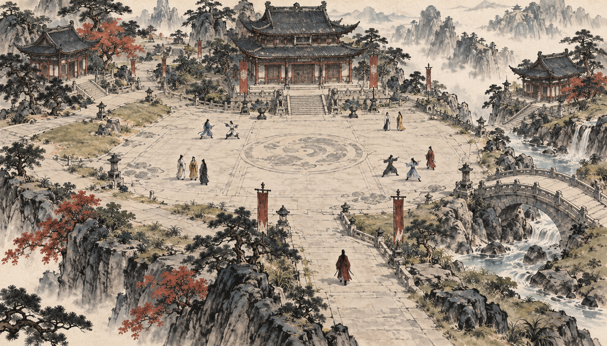
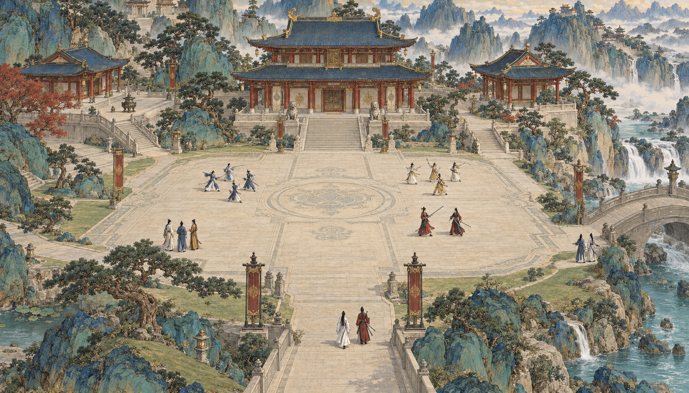
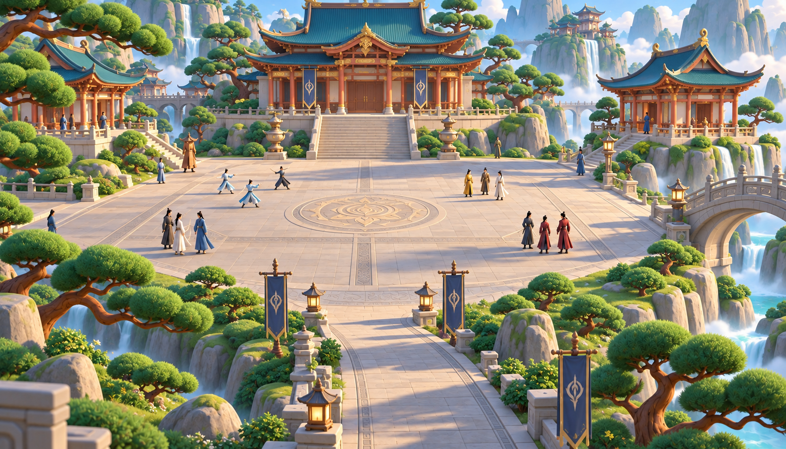
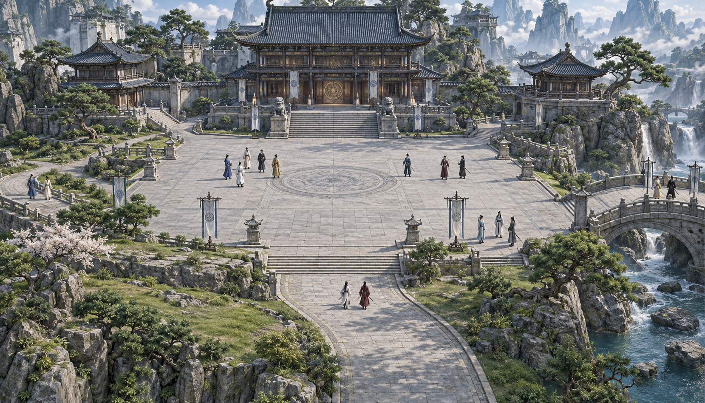
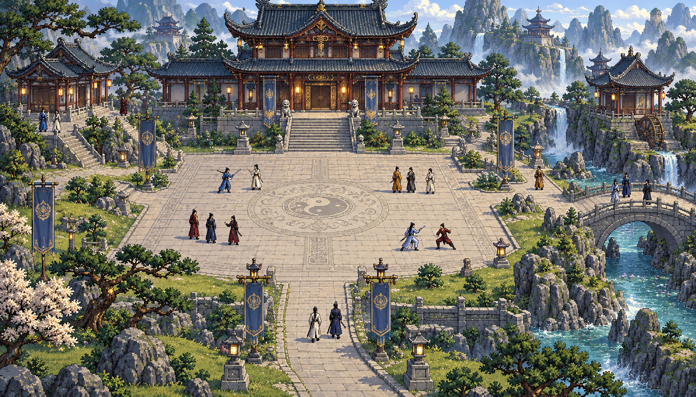
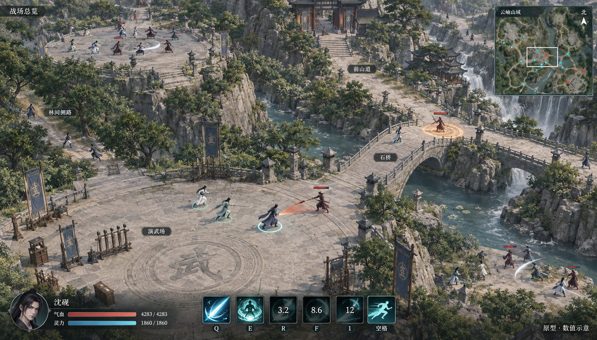
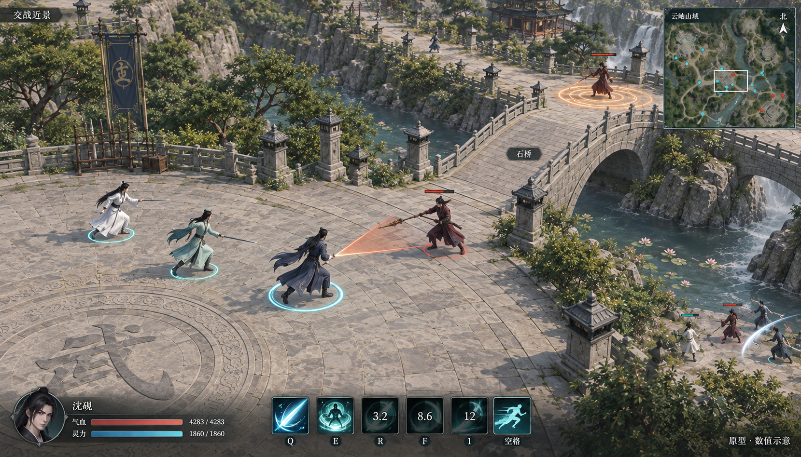

# 桌面版画风与即时战斗原型

2026-10-13，U-127 / U-128。交付方向为桌面游戏：Windows 是主要交付平台，前期在 macOS 开发验证。场景面向可供多人同时交战的连续大地图，战斗采用即时行动与技能冷却。本页为静态画面评审，画风、镜头、界面与具体数值待用户审核；桌面迁移和新战斗尚未实施。

## 五种画风

五张以主殿、广场、侧殿、石桥和人群为共同场景要素，比较材质、轮廓、人物与空间的表现。建筑群是画风测试样例，开局仍需按营造阶段呈现。

| 选项 | 方向 | 主要特点 |
| --- | --- | --- |
| A | [水墨写意](a-ink-wash.png) | 墨色笔触、宣纸底色、少量朱砂与靛蓝。 |
| B | [工笔设色](b-gongbi.png) | 精细线描、矿物设色、建筑与山石的绘画质感。 |
| C | [动画电影质感](c-animated-3d.png) | 风格化体积、柔和光照、清楚的材质与造型。 |
| D | [写实国风 3D](d-realistic-3d.png) | 自然比例、石木材质、写实空间与日光。 |
| E | [高清像素](e-hd-pixel.png) | 可见像素笔触、角色精灵与层次化场景。 |

### A · 水墨写意

### B · 工笔设色

### C · 动画电影质感

### D · 写实国风 3D

### E · 高清像素

## 多人即时战斗

战斗图使用中性的三维呈现来审视布局，不代表五种画风已选定。总览展示相连的广场、石桥、林间侧路与高地，近景放大桥头交锋。地图继续延伸至镜头外，小地图的视野框表示当前可见范围。

本次构图以约24–30名角色分散交战为目标，作为画面容量样例；实际人数上限与地图尺寸未确定。掌门双环、友方青色脚环、敌方赭红脚环、少量受伤血条用于识别；技能范围在地面提示，冷却用图标遮罩和剩余秒数显示。图中血量、灵力、键位和冷却数值全部是排版示例。

### 战场总览

### 交战近景

## 制作与审核边界

七张最终图均由内置 image_gen 生成，原始 PNG 保存于本目录，未接入游戏。画风提示词见 [PROMPTS.json](PROMPTS.json)，C 的最终提示词见 [C-STYLE-PROMPT](C-STYLE-PROMPT.md)，战斗两图见 [BATTLE-PROMPTS](BATTLE-PROMPTS.md)。

本轮已目视核对五种表现方式及战斗界面的角色、场景、预警和冷却呈现。静态图可供选择视觉与构图；人物动画、实时前摇、多人特效密度、寻路、帧率、存档与 Windows / macOS 原生运行均需后续实际原型验证。本批没有实施或发布新运行功能，完整 SR/AC 状态保持。
