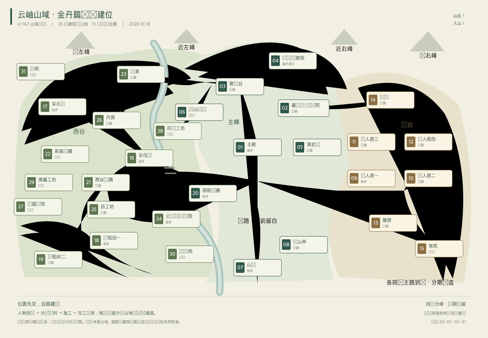

# 金丹篇山域 · 批准总图

2026-10-18。U-166 / U-167 / R-54。用户已批准25项建筑与场地、31处预设建位的整体构图，并要求按此开发。范围覆盖主峰、东台、西谷；四座分峰保留长期山域关系。

## 整体场景

图为内置 imagegen 制作的1536×1024整体场景概念，沿用原山院蓝灰瓦、木梁、暖灰石和高清像素环境。主殿宽庭及南侧长阶为中心，东侧生活院落、西侧田地和工坊、后山修行区依山势展开。参考图、两轮提示词、原始路径与素材检查见[制作记录](IMAGE-PROMPT.md)。

这张图负责材质、地形和建筑群构图。可辨屋舍尚未逐栋映射到31个编号位置；预设分区与相邻关系以以下编号图和58号规格的批准布局为依据。分区像素母稿逐批合并两者，校准真实占地、入口、工位与施工画层；具体位置与运行效果以各批实际成果记录。

## 编号建位

[可编辑SVG](site-plan.svg) · [位置索引](site-plan.json) · [完整建筑清单与功能](../../design/58-GOLDEN-CORE-PRESET-BUILDINGS.md)

编号图为独立绘制的空间示意，25项建筑与场地、31个位置；图内数字是规划编号，不是游戏实体ID。SVG绘图坐标用于表达相邻关系，不能直接作为世界米制坐标导入。31个位置中，09复用既有东台建位；01/20对应原殿及原药圃，接入时保持现有身份。

## 总图制作核对（U-166）

- 当前14类经营定义全部出现在清单；主殿、丹房、膳房、护山亭各保留一处，符合现行唯一设施定义。
- 25项加四处住宅的3个重复位、两片稻田的1个重复位、三片药圃的2个重复位，共31处；图号连续且唯一。
- 三名子Agent分别核对营造目录、百艺工位及篇章山域；另由两名子Agent复核58号稿，已修正医庐床位口径、搬运物所有权、净水维护工位及毒煞设施独立启用条件。
- 根Agent检查两张图：编号图文字可读，整体图建筑群、山路、溪流与坡地统一；具体31位的美术对应、米制比例及施工状态仍须下一轮分区校准。
- 编号索引已核对31处连续唯一、25项分组、14类现行定义全覆盖及4类唯一设施各一处；SVG文字框无相互覆盖，新增文档26处本地链接有效。台账refresh/validate及工程检查通过。
- 总图制作阶段为文档与美术设计，未进行游戏运行验收；正式状态按[STATUS](../../design/STATUS.md)及台账记录。单项SR/AC状态保持。

## 分区接入（U-167）

按批准总图，先接通原院—西桥—GC-16西林采伐场的同机位近景及施工阶段，落实实际走路、运料、营造、生产、搬回公库与途中存读，再按分区扩展。整体构图批准与分区像素表现、米制校准、运行验收分别记录。

当前运行目录已登记31处：GC-01原殿与GC-20原药圃沿用既有实体，GC-09东台门人居与GC-16西林采伐场为已接入工程入口，各自按通路和营造条件开放；其余27处待分区接入。西林桌面实机验收在本次文档登记时仍待完成，具体状态见[58号规格](../../design/58-GOLDEN-CORE-PRESET-BUILDINGS.md)及[STATUS](../../design/STATUS.md)。
