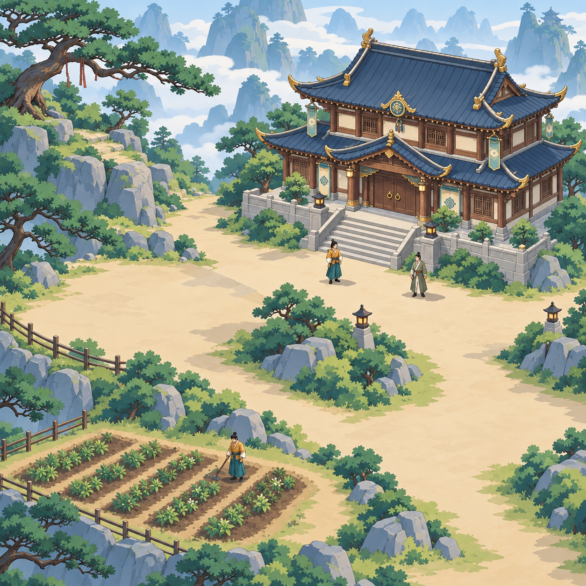

# 云岫山院 · 清爽国风平涂原型

2026-10-13，U-126。用户选择“大色块、清楚轮廓，建筑人物容易辨认”的清爽国风平涂方向，并要求继续接入游戏。本图保留为风格参考；对应的独立平涂素材已接入云岫山院，实际运行记录见 [RUNTIME](RUNTIME.md)。

地面与远山保留大块安静区域，树石以色块组织，主殿形成场景中心，人物有清晰轮廓，药畦连接所在土地。运行素材中的地形、建筑及施工、药田作物阶段、人物、阴影和遮挡独立呈现，同一模拟与存档决定状态。本地实际网页已完成主殿、药田与陆知微点选；更多验证和发布进展以 [RUNTIME](RUNTIME.md)及 [STATUS](../../design/STATUS.md)为准。接入后的用户美术评看和目标真机仍待验，完整 SR/AC 状态保持。

原型由内置 imagegen 编辑同视角构图参考生成；提示词见 [PROMPT](PROMPT.md)。
