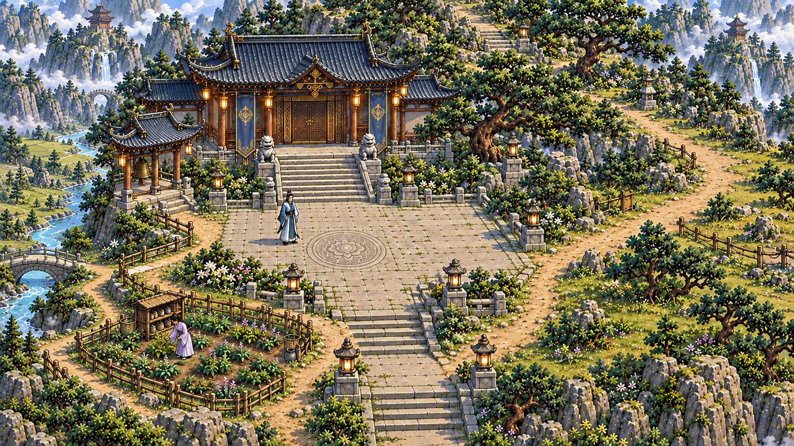
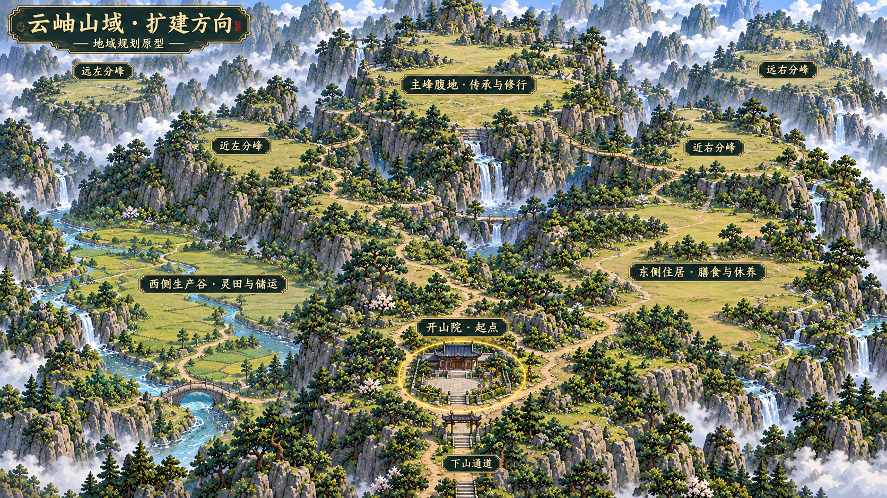
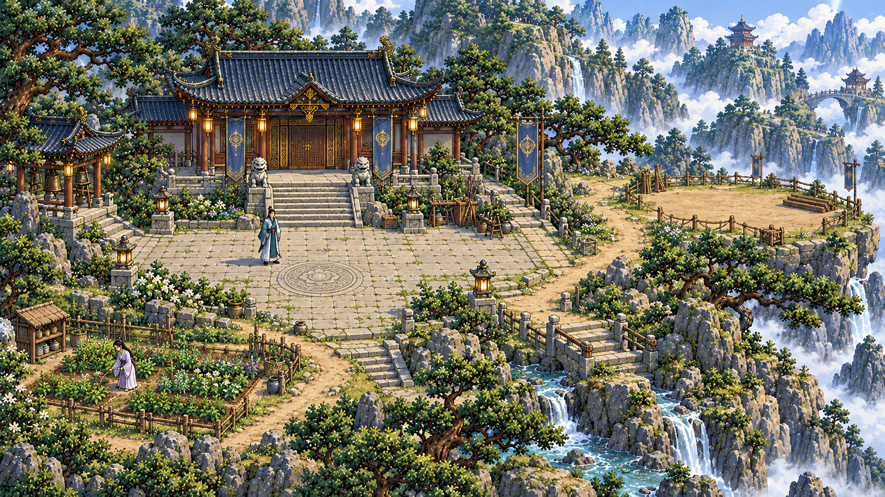

# 云岫山院美术原型

## 山院近景母稿 · 2026-10-15

U-144：用户已确认按以下母稿开始还原。母稿以演武场作为材质参考，在总图开山院位置表现一殿、药田、松岩和两位人物；首屏源码入口为 `prototypes/pixel_scene_validation/courtyard.html`，实际交付与验证见 [首屏运行记录](RUNTIME.md)。

院右的道路沿连续台地通向东侧生活区；院左从土路下坡至溪桥与生产谷；院后石阶上行通向主峰腹地；前方石阶向南出画。南侧山门位于本图之外。

实际输出1672×941像素，原图直接保存；版本与尺寸见[素材记录](courtyard-v2.json)，内置 image_gen 的完整提示词见[制作记录](NEARVIEW-PROMPT.md)。首屏使用原尺寸环境和独立人物，静态原图、实际截图、状态变化及运行证据分别记录。首屏实机经用户认可后，再延展相邻地区。

本批关联 SR-XF-003-AC-01/02、SR-XF-004-AC-01/02/03 和 SR-XF-007-AC-01/03；首屏行走、点选、失败反馈及存读按运行记录登记局部证据，完整 AC 状态保持。

## 山域扩建方向

用户继续追问扩张方向后，补充山域总图：开山院处于主峰山腰的一角；东侧连续台地用于住居、膳食与休养，西侧谷地用于生产和储运，主峰腹地用于传承与修行，近侧及远侧四座分峰承接后续生活圈。地域关系沿用[山域规格](../../MOUNTAIN-DOMAIN.md)与[成长章程](../../SECT-GROWTH-PLAN.md)。

用户已认可此图的扩建方向，并要求说明材质、精度与原型一致性的保证办法。此图表达可开发土地和连接方向。各区域的具体面积、容量、道路长度和营造条件尚须配置；不以图上建筑大小反推米数。后续山院近景须在该整体布局中固定位置、地标和出口，再还原细节。下方首张近景的四周地形未充分表达连续扩建空间，其美术细节与整体布局审核分开。

生成方式与完整提示词见 [EXPANSION-PROMPT](EXPANSION-PROMPT.md)。后续制作的[保真验收方案](FIDELITY.md)与[原图版本记录](reference-baseline.json)已写明；上方U-144记录近景母稿认可后的首屏还原。

## 首轮山院近景材质参考

2026-10-14，U-142。用户要求先制作完整山院原型，再按审核后的构图、细节、精度与材质还原实机场景。本轮使用内置 image_gen，并以已认可的演武场 `assets/courtyard-v1.png` 为直接风格参考。

这是首轮美术原型，主殿、前庭、药田、两位人物、松石山势与通往东台的路径在同一张完整构图中建立关系。后续采用上方v2母稿还原，实际运行证据另行登记。

后续还原以同机位对照为准：先核对完整构图与人物尺度，再核对瓦片、木构、铺石、药田土壤和松岩的材质密度，最后逐层检查接地阴影、前后遮挡、道路接缝与行走。近景确认后再延展相邻地形。

生成方式与完整提示词见 [PROMPT](PROMPT.md)。U-142当时暂停场景接入与20分钟长验；U-144已恢复首屏还原，经营长验待首屏评看后接续。
