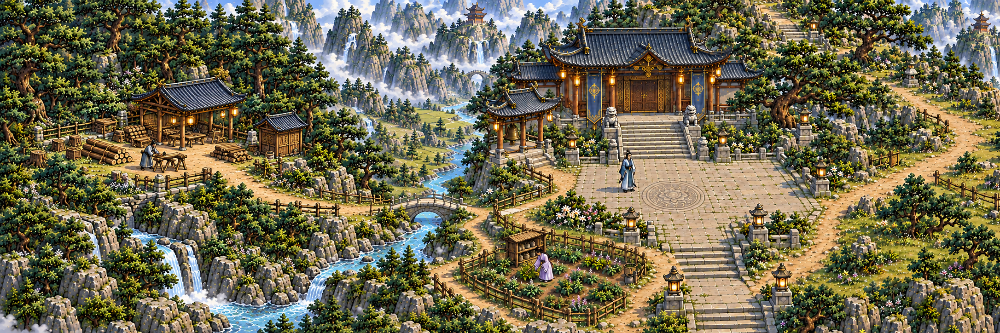

# 主殿与西侧采伐场 · 整体场景稿

2026-10-18，U-165。当前为整体构图候选，供确认预设采伐场、主殿、林地和道路关系。游戏接入、精确空间映射及施工阶段另行制作。



主殿与原药田位于右侧；西侧石桥接入林缘作业场，工棚、工具小屋、木料区与周围树木、坡岸一起绘制。预设建位确定后，对同一场地制作未建、施工、完工三种画面，人物按实际路径运料和修建。

本稿参考`assets/courtyard/courtyard-master-v2.png`，由内置imagegen生成，尺寸2172×724。该图用于构图评看；原院运行坐标、存档与既有场景素材未由此替换。原世界西侧扩展须支持明确的最小坐标，保存旧人物、建筑和工单位置。

## 实际提示词

```text
Use case: precise-object-edit. Asset type: overall scene-design review for a fixed-camera high-definition pixel Chinese xianxia sect game. Edit target: supplied approved courtyard master image. Extend this environment naturally WESTWARD (to the LEFT), producing one wide coherent landscape panorama, approximately 3:1 aspect ratio. Keep the whole original main hall, its clear front forecourt, herb field, monumental pine, eastern path, stairs and original architecture in the right portion at their existing relative scale and camera angle. The new western part should add roughly one screen of real usable landscape connected to the original west-side stone bridge and path. The image is a single authored terrain and building scene.
New left portion: a wooded mountain terrace with an existing natural dirt branch path crossing from the west bridge toward a small permanently planned timber harvesting yard at the forest edge. Compose the logging work yard integrally with the terrain: low weathered retaining stones shaped to the slope, a modest completed timber work shelter set into the forest terrace, one small closed tools store, sawing stand and a neatly stacked timber area around a compact accessible working clearing; mature pines continue naturally around it, a few stumps at the forest edge suggest actual cutting. Building positions are fixed parts of the landscape design. The path visibly reaches the front working clearing and continues back to the original courtyard. Keep a real belt of trees and elevation between the work yard and the hall; the court and its entrance remain spacious. The timber shelter should be much smaller than the main hall, ordinary human height, same roof pitch, material language, warm light and blue-grey shadow as the approved environment. At most one tiny 1.8m worker by the site for consistent scale; use reference human proportions.
Style: EXACT same refined high-definition pixel game art as input, tiny crisp pixels, dense restrained natural textures, blue-grey tile, olive pines, warm grey limestone, muted timber. Same fixed front-oblique orthographic camera and same viewing elevation. The new terrain has connected mountain contours, stream continuation, bridge, paths, rocks and forest rather than floating objects. Single cohesive lighting and continuous depth. No labels, UI, arrows, labels of build sites, selectable outline, white grid, graphic frames, floating ground islands, exploded diagrams, rendered model look, or a pasted cutout building. Show the completed layout as a SCENE CONCEPT, not a screenshot. Preserve the approved courtyard architecture and visual identity. Return local path.
```

工具原始输出保存在`/Users/shepard/.codex/generated_images/01a144ea-e43f-7960-aba6-4800a2ad7db7/exec-db5500c6-d61d-402e-b40d-48273472d50b.png`；项目候选文件为本目录`west-forest-scene-v1.png`。
