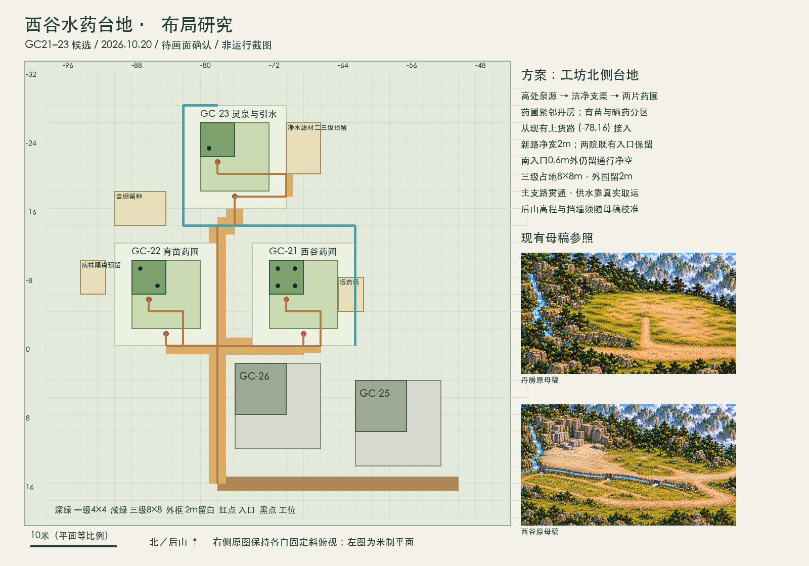

# 西谷水药台地布局研究

2026-10-20。依据U-167/R-54、58总图、46连续山域、山域成长章程与GC21–23锚点brief。当前为**待用户画面确认的候选布局**，米制候选保存在本目录，运行目录与17处既有接入状态继续沿用现状。

[比例SVG](layout-study.svg) · [候选坐标与入口](layout-candidate.json)

## 选择的场地

采用brief路线B的北侧延展：在现有丹房／百工坊之后增设水药台地，灵泉位于台地上缘，育苗在西侧、药圃在丹房北侧。批准总图只约束分区及相邻关系；本候选落实“高处泉源—洁净支渠—药圃／苗棚—丹房”的关系。新增图块、步行面与上台阶共同制作，已有丹房、百工坊、上货路继续使用原坐标。

亲自查看的当前原图：`assets/courtyard/west-valley-empty-v1.png`、`west-workshops-workshop-ground-v3.png`、`west-workshops-alchemy-ground-v2.png`及批准编号图。现有图上岩壁、树林、溪流和宽路占据接缝，新增区域须画出真正可站立的台地；图中左侧是17px/米的正投影平面，右侧仅为现有固定斜俯视参考。几何示意不表示最终像素美术。

## 米制候选

| 建位 | 一级左上/占地 | 三级最大占地 | 一级南入口 | 三级南入口 |
|---|---|---|---|---|
| GC21 西谷药圃 | (-72,-10)，4×4米 | (-72,-10)，8×8米 | (-70,-5.4) | (-68,-1.4) |
| GC22 育苗药圃 | (-88,-10)，4×4米 | (-88,-10)，8×8米 | (-86,-5.4) | (-84,-1.4) |
| GC23 灵泉与引水 | (-80,-26)，4×4米 | (-80,-26)，8×8米 | (-78,-21.4) | (-76,-17.4) |

采用西谷既有4/6/8米分级占地约定作为候选，不增加容量参数。每处三级外沿另留2米场地余量，门外0.6米作为入口脚点；后续仍须验证成人完整身体和门口持有权。三级范围的2米带为绿地／维修走道，附属晒药、苗棚等可利用该带，但不得占用门外通道。

GC21四个一级作业脚点为(-71,-9)、(-69,-9)、(-71,-7)、(-69,-7)，晒药场在东侧(-64,-8)起3×4米。GC22两个作业脚点(-87,-9)、(-85,-7)，苗棚留种区在(-90,-18)起6×4米，病株隔离在(-94,-10)起3×4米。GC23取水脚点(-79,-23)，净水槽及滤材维护在(-70,-26)起4×6米预留，属于二三级用途；脚点与设施需随同机位母稿复核，不据本图增加工位容量。

## 通路与母稿制作范围

- 接入点为现有上货路(-78,16)。新支路沿x=-78向北到y=0，再通两片药圃南侧；继续向北抵泉。主支路建议净宽2米，一级短支路1.6米，均为待制作参数。
- 一级与三级入口分别列出，扩建时切换支路；升级占地清空前保留原合法出入。现有GC26三级预留为(-76,2)起10×10米，GC25为(-62,4)起10×10米；候选新主路中心距GC26预留西缘2米，2米宽路外缘仍有1米间隔。
- 米制负y仅代表当前投影的后山方向；高程、挡墙、坡度、台阶尚待母稿校准。泉源须在画面上高于清洁支渠，禁止从岩壁／溪水上穿行。
- 采用当前`courtyard-space.toArt`测得候选艺术坐标，详见JSON。北侧母稿包络art x=-7524..-4180、y=-2232..591，为2列×3行1672×941的制作预算；下排承担透明接缝围裙，须按旧院落、道路及遮挡轮廓裁切，不能整块盖住现有丹房和百工坊。包络是制作上限，正式贴片数量与裁切尺寸待画面确认后测定。
- 需承接现有工坊母稿上沿y=-350及北侧岩壁，保留64像素接缝测绘带。主接路的下段在现有背景内，必须新增可站立地面贴片和对应步行面；不得只延长导航线。
- 画层依58/brief：未建地貌、基础、木架、完工及二三级升级；封闭苗棚等完工保持外观，露天工作者按真实脚点可见。111像素成人、140像素门扇作为现有同机位参照；本平面图不可替代该比例验收。
- 蓝色是泉源和支渠的空间预留。洁水交付仍通过真实取水、携带、运输和现场库存；渠道图形本身不提供自动送水能力。

## 规则与功能边界

已具规则：GC21沿用farm（2灵草→12灵草）；GC22按T-27（3灵草、生长160步、照料240贡献、产18）；GC23按T-28（生活物资已启用后，200贡献产12洁水）。普通灵泉仍产4灵晶，GC23现有解锁为阶段2＋筑基，布局研究不改门槛、成本与供给规则。

仍待实际成立：三处锚点、可行走地面、入口/选区/阶段外观；GC22病株隔离和移栽操作；GC23净水槽／滤材维护和人工灵脉接引的二三级功能；完整正常种植、取水、送库及丹房/膳房送达。场地预留不表示这些功能已经实现。原院GC20继续保留，21/22稳定送达后才讨论用途转换。

## 本轮检查与接续

已完成：原图视觉检查；当前geometry只读导出；31处目录状态核对；三处候选三级矩形互不重叠的静态检查；PNG实看与SVG/JSON读回。本轮没有启动游戏、生成最终素材或把候选写入运行。

下一步是用户确认台地的画面方向，然后制作同机位母稿并校准米制占地、工位和道路。之后才进入正式锚点接入及正常／失败／途中存读验证。检查脚本和原始几何导出在`/Volumes/Media/immortal-qa/sol-sites-20261020/`。
