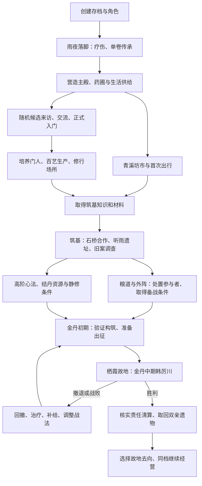

# 37 · 余烬立山：建档至金丹复仇

> **暂存草案（2026-10-12）：** 用户认为当前跨到完整复仇篇章的步幅过大，要求先考虑尚未完成的系统与场景。本稿作为远期参考保留，暂缓扩写与实施；章节、地图、人物配置、数值和开发批次尚未整体确认。当前工作应先收束可实际游玩的局部流程，具体下一批另行确定。本稿没有对应的新游戏实现或完整验收。

日期：2026-10-12。版本：首轮整合草案 0.1。用途：确定第一阶段的完整玩家流程、详细设计范围与开发顺序，供后续 Sol high 接续。

**U-121 已确认的是交付终点、随机门人和人数／境界边界；R-40 是本轮作者方案。** 章节安排、地图体量、人物配置、战斗参数和工期均须分别管理。本次交付设计文档，实际运行状态见 [STATUS](STATUS.md)。

## 1. 第一阶段交付什么

玩家新建存档，以流亡后的沈氏遗孤落脚云岫山院，疗伤取得母亲留下的一卷传承；营造住处、建立供给、结识并招收随机门人，前往地方场景取得知识与资源，经历炼气、筑基、结丹，最终以金丹初期迎战金丹中期的直接仇敌。旧案责任清算、双亲遗物取回、故地去向决定后，继续使用同一存档经营。

| 边界 | 本轮结论 | 来源 |
| --- | --- | --- |
| 门人数 | 同时在籍上限 15 人，掌门另计；离宗或身死后可补招 | U-121，用户本轮答复 |
| 门人生成 | 随机人物、不同天赋；生成后有持久身份、经历、外观和关系 | U-121 + 05 的身份契约 |
| 玩家上限 | 第一阶段最高金丹初期，通过准备与配合挑战金丹中期仇敌 | U-121，用户本轮答复 |
| 主线终点 | 从建档到复仇成功，结局后继续经营 | U-121 + U-04 |
| 直接控制 | 玩家控制掌门；门人自主接受工作、学习和同行邀请 | U-02 |
| 开局与画面 | 新云岫山院临时落脚，随后营造主殿；Godot 2D、固定斜俯视、游戏式卷册界面 | U-102、U-117、U-120 |
| 剧情责任 | 以韩厉川为金丹中期终局仇敌，保留邢烈、邵衡的原有参与事实和稳定身份 | R-40，调整 R-26 的新篇章配置 |
| 同行规模 | 沿用掌门加至多两名自主同行者；门人可在山院、补给、侦察及准备中发挥作用 | R-40，承接现行旅行／战斗契约 |
| 养成一致性 | 本首篇新档的门人与掌门共用金丹初期成长上限；天赋改变成长条件和效率 | R-40，普通人物仍可培养 |
| 兼容 | 已完成旧档保留原结局；更高境界／更多成员旧档保留事实，采用兼容规则 | 05 + R-40 的迁移建议 |

15 人是组织容量。玩家可在人数较少时完成主线，名额不作为出门、筑基或决战的钥匙。世界中的访客、商旅和剧情人物另有身份，临时停留仍实际占用床位、食物和场地。

## 2. 需要详细设计哪些内容

以下内容都需要设计到“玩家能够怎样做，游戏应如何回应”。剧情梗概、地图画稿或武学名称单独完成，只能算该项的一部分。

| 设计包 | 必须写到的深度 | 本轮入口 |
| --- | --- | --- |
| 建档与开局 | 档位、身份、世界种子、改名、单卷传承交互、疗伤、立殿、第一名随机候选、暂缓后的恢复 | 本文 §4、38／39 |
| 主线剧情 | 事实与知情分离；每章进入条件、场景动作、可靠线索、拒绝／失败后果、结局一次结算 | [38 世界与剧情](38-FIRST-CAMPAIGN-WORLD-STORY.md) |
| 地图与场景 | 地方路线图、行程成本、局部可走空间、入口出口、遮挡、交互点、危险与可撤退路线 | 38 |
| 场景人物与道具 | 具名剧情人物的职责／利益／位置；随机人物的生成来源；每件物品的所有者、来源和用途 | 38、39 |
| 随机门人 | 天赋维度、合理组合、识人方式、来访周期、入门意愿、三级门籍、15 人容量、离宗／身死／补招 | [39 门人与经营](39-FIRST-CAMPAIGN-DISCIPLES-ECONOMY.md) |
| 经营与百艺 | 生活、修行与生产供给；配方、工位、产物、队列、缺料／伤停；扩建的资源和真实容量 | 39 |
| 修行与传承 | 五种开局贯通至金丹的续修／转修路线；境界条件、材料、练位、功体和可实际使用的动作 | [40 修行与战斗](40-FIRST-CAMPAIGN-CULTIVATION-COMBAT.md) |
| 战斗与敌人 | 即时操作、暂停、起手／收势、空间命中、抗性、异常、同伴决策、阵法、神通、撤退与疗伤 | 40 |
| 支线与事件 | 招募、合作、资源、装备、情报、救援、稀世暗线各自改变什么；关键路线有替代 | 38、39 |
| 游戏界面 | 每个页面的主要任务、进入／返回、选中反馈、按钮真实命令、不能执行的原因 | 本文 §7 + U-120 |
| 资产与表现 | 地形层、建筑阶段、人物动作、攻击预警、互动状态、音乐／音效触发清单 | 38、40、本文 §8 |
| 存档与验收 | 中途保存、随机保持、物资守恒、战败再来、死亡遗物、篇章完成、旧档保护 | 本文 §9、实施交接 |

设计顺序先定终局的实际挑战和到达条件，再倒推结丹、筑基、供给与开局。先把这些约束串起来，后续对白和美术才能围绕实际玩法展开。

## 3. 玩家流程总图

图为正常推荐顺序。调查、经营和准备可以交叉；已知且可达的地点允许玩家承担风险提前探索。可靠信息用于知道敌人在哪里、怎样应对，章节不会以“收集若干证据”审批复仇。

| 玩家阶段 | 主要体验 | 成长与经营目标 | 能证明这一段成立的动作 |
| --- | --- | --- | --- |
| 建档与落脚 | 带着伤势和遗物活下来 | 选定身份与单卷传承，学会移动、疗伤、保存 | 刷新后仍在原地点，草药只消耗一次 |
| 山院初立 | 与不同的人共同生活 | 约 1–3 位门人的经营样本；主殿、住处、药田和仓储可用 | 候选有权拒绝；掌门可补足缺工；首产真实入库 |
| 通商与筑基 | 山外行动开始反哺山院 | 约 3–6 人的供给样本；取得突破知识和材料 | 有准备地出行、交易／战斗、带回实物、实际筑基 |
| 追索旧案 | 情报和战术改变可选路径 | 筑基中后期；约 6–10 人，补炼丹／炼器／阵法能力 | 查到具体责任和行程，改变粮道或外阵事实 |
| 结丹与备战 | 经营积累成为战斗准备 | 金丹初期；约 10–15 人容量样本，普通人才也可支撑 | 续修／转修、结丹、邀同行、携物、安排留守 |
| 复仇与余生 | 兑现前面所有投入 | 打赢金丹中期仇敌，完成旧案 | 死亡／遗物／关系／结局保存，回山仍能经营 |

上述人数是体验与容量检查样本；章节不检查这些人数。游玩时长先测首段和一次出行循环，再评估整篇，不用未测的小时数承诺内容量。

## 4. 建档与随机门人的第一步

### 建档

1. 在空档位创建世界，记录首篇内容版本、随机种子和主角身份。覆盖已有档位需明确确认并保留恢复办法。
2. 主角沿用沈氏遗孤、炼气六层和既有天赋背景，玩家可改显示名；主角不是随机门人生成器的第一个样本。
3. 姓名／外观选择与五条传承的单卷游戏交互保持一致；五条开局内容仍为青岚、赤阳、寒泉、厚土、金锋，每条获得心法、一攻、一守。
4. 首次疗伤后的包裹场景暂停同一世界，确定传承、返回山院及中途存读都有明确恢复点。
5. 首个随机候选的出现由可靠入门事件调度；其姓名、外观、天赋、志向与处境从匹配模板生成。事件提供接触机会，正式入宗仍要本人接受。

### 剧情人物与门人

陆知微等既有具名人物保留各自的经历和关系。新篇章以随机候选承担可招门人来源，陆知微可通过赠药结缘和自愿协作支撑早期教学；主线不要求她占据一个门人名额。旧档中已经正式入门的人物保留门籍、关系与计数。

门人的成长记录包含先天条件、后天修习与真实经历。候选生成后换场景、打开名册、存读和重复邀请都保持同一人；候选离开后仍可在世界中留下行程和关系。

人才差异要让玩家做安排：悟性好的研习快、体魄好的适合前线、灵植熟手缓解供给、志向不同影响工作和留宗。天赋不直接等于忠诚，普通人通过训练仍能形成职业与战术价值。完整字段、随机规则及招募流程见 39。

## 5. 地图、人物、物品和支线如何控制范围

### 地图分三层

- **五洲世界图**提供已知地域和世界背景。
- **云岫地方图**承载本篇可出发的路线、地点、行程、消息和危险。
- **局部游戏场景**承载走路、对话、采集、交易、布阵、战斗和撤退。

本篇通关资源在云岫地方范围内闭合；去晟安等远方内容继续有其自己的开放条件。将现有山院、山谷、坊市、石桥、遗址、粮道／偏牢和栖霞连接成实际可走通的行程，再按 38 增补结丹需要的地点。每处场景围绕用途制作，重要地点有回来后发生变化的理由。

### 人物分工

具名剧情人物写固定真相、利益、日程、所知和去向；随机门人写生成与成长规则；普通商旅、护卫、敌人按地域和职责生成。主线关键人物死亡或错过后，账册、遗物、交易对手或现场残迹接续相应信息，存档中保留原后果。

### 物品需要完整来源链

每件主线物品、突破材料、典籍和独特装备都要写：`谁持有 → 在哪里 → 怎么获得 → 做什么 → 消耗/转移到哪里 → 失败如何补救`。关键晋升内容至少有一条可靠正常来源，核心稀缺资源采用探索与付费合作等不同成本的替代。

### 支线的四种价值

1. 改变人：救援、合作、信任和后续招募机会。
2. 改变生产：取得方子、材料渠道、工位或维护知识。
3. 改变战法：得到一件有用途的器物、一套动作或布阵知识。
4. 改变局势：掌握敌方行程、削弱实际补给、打开道路或争取中立。

重复委托负责有限交易和日常供给；重要支线有独立因果和持久后果。每条都要标明与主线的关系：可靠成长来源、可选准备或独立故事，避免玩家以为所有支线都必须清空。

## 6. 战斗与养成的关键判断

**金丹初期挑战金丹中期可以作为同一大境界内的终局设计，是否好玩仍需战斗样本证明。** 敌人的正面压制、玩家的动作选择、同伴配合和战前准备必须同时成立。若只增加敌人血量，前面的调查和经营就缺少可感知的用途。

本轮建议：韩厉川延续重刀刚猛与自有传承。侦察让玩家知道其动作和供给；断补给、处理阵眼、准备护具、邀合适同伴分别改变场地或可执行动作。敌人保持金丹中期；筑基同伴可协助破阵、救护、牵制局部威胁，仍要承担直接吃中金丹攻击的风险。

现行战斗已具备部分即时动作和至多两名同行者，但同行主要仍按基础战术行动；物抗／法抗／异常、五线高阶成长和神通不能按目录存在就视为可用。40 给出具体补齐内容及测试起点。

五条开局都必须有从炼气到金丹初期的正常路径：有的续修，有的在筑基后转修可靠高阶心法，攻守动作分别升级。选择一部心法不应自动获得整条攻击树。神通按具体参悟条件生成修成机会，目录只是内容定义；取得书册不能直接变出神通按钮。

4900 项保持五洲长期目录。第一阶段先把实际选择的心法、动作、神通和百艺做成有来源、有前置、有表现、有反制的可执行子集；逐项列“目录已写／来源已定／规则已接／画面已接／实测”，再决定扩写额度。

## 7. 各个游戏页面让玩家做什么

| 入口 | 打开后先看什么 | 主要操作和返回 |
| --- | --- | --- |
| 掌门 | 本人状态、功体、装备和当前行动 | 换装、疗伤、修炼；定位回到本人 |
| 门人 | 谁在宗、谁外出、谁需要照顾 | 筛选／选人 → 身况、修行、关系、职责；邀请并显示实际回应 |
| 功法 | 已持有与可研习的传承，当前修习路线 | 选典籍 → 章节、招式、来源、条件 → 开始研习／寻访 |
| 行囊 | 当前携带物与实际存放位置 | 使用、装备、取物、存放、赠予；到场与耗时仍由世界执行 |
| 百艺 | 配方／图谱、原料和真实工单 | 选方 → 看产物 → 数量、匠人邀约、工位 → 确认 → 查看产物去向 |
| 任务 | 正在关心的事、最近消息、可用线索 | 跟踪、回看知情、定位已知地点；不显示作者真相 |
| 山外 | 已知地点、路线与旅队 | 查看行程和消息 → 准备携行物 → 邀同行 → 实际出发／回程 |
| 宗务 | 在籍容量、生活供给、规则与财物安排 | 正式收录、门籍、职责邀约、生活／修行供给安排 |
| 院景营造 | 可用地块与实际设施 | 选择工程 → 预览与条件 → 下单 → 实际施工／取消 |

继承 U-120 的居中大窗口、青玉云纹、书写标题和图案。常态显示当前行动所需信息，长说明通过选中或展开提供。每个绘制出来的主按钮都对应真实行为；返回后保留所选人物、条目和滚动位置。

## 8. 开发流程与分工

详细任务卡、代码范围及接续提示词见 [第一阶段实施交接](../FIRST-CAMPAIGN-IMPLEMENTATION.md)。建议按下列批次推进，每批交付一条可实际演示的操作链。

| 批次 | 可评看的成果 | 主要前置 |
| --- | --- | --- |
| B0 设计与共同规则 | 冻结本批定义、编号和旧档映射；做可标明用途的战斗实验，校准初对中期的反制窗口 | 37–40 评看；SR 影响表 |
| B1 新档与随机收徒 | 建档 → 疗伤 → 单卷传承 → 立殿 → 首次随机来访 → 入门 → 存读 | 候选生成、容量和身份 |
| B2 山院与百艺 | 采集／交易 → 搬运 → 炼制／打造 → 入库／装备 → 维持生活与修行 | B1 的人、设施和库存 |
| B3 第一条山外闭环 | 准备 → 邀同行 → 出发 → 场景交互／遭遇 → 撤退或获物 → 回院使用 | B2 供给；真实场景和基础战斗 |
| B4 筑基与构筑 | 五开局分别可靠晋升筑基；武学、术法、身法和阵法形成用途差异 | B3 的来源与战斗 |
| B5 追索与局势 | 账册／伤匠／遗址调查 → 粮道、偏牢、外阵行动 → 持久准备与责任处理 | B4 成长；38 的分支 |
| B6 结丹与决战 | 双路取得结丹条件 → 金丹初期 → 备战 → 挑战／撤退／恢复 → 韩厉川战胜 | B5；40 的晋升和敌人规则 |
| B7 收束与完整交付 | 三责任事实核实 → 遗物 → 故地去向 → 继续经营；正常新档贯通与旧档兼容 | 前面所有批次 |

并行分工围绕稳定边界：一人负责共同命令／时钟／存档和集成，一人负责剧情／地图内容，一人负责养成／战斗，一人负责独立验证或 UI。共享文件只由其责任人写入。素材制作可以并行，但先用一个完整场景校准人物比例、遮挡、预警和交互，再按同标准扩展。

B0 的战斗实验可使用注明来源的边界样本，只回答动作与机制问题。B6/B7 仍须用正常获得资源的存档证明可通关。日历工期在 B1–B3 的实际工作量有记录后再估算。

## 9. 第一阶段的完成标准

下列 `FC` 是本轮新增验收草案，全部为 **未运行**。B0 将其映射到原 SR/AC 并对变化条款登记版本；原证据保留其原范围。

| ID | 必须证明 |
| --- | --- |
| FC-01 | 正常新档完成建档、疗伤、单卷传承与立殿；待选、施工中保存恢复正确 |
| FC-02 | 不同种子产生不同候选，同档重载保持同一候选；天赋公开信息来自实际查验 |
| FC-03 | 第 15 名入门成功，第 16 名被明确拒绝；并发收录只剩一席时不超额；离宗／核实死亡并注销门籍后可补招，失联查证期间保持占席 |
| FC-04 | 普通天赋门人通过研习、劳动与设施支持实际成长；无人接受某项工作时有掌门或外部合作替代 |
| FC-05 | 16 名本宗人物及在场访客实际占床、吃饭、搬运、生产和修行，容量／供给／私产正确 |
| FC-06 | 五种开局各有真实来源走到筑基和金丹初期；本首篇新档成长上限正确，失败或中断后可恢复 |
| FC-07 | 山院 → 地方路线 → 局部交互／战斗 → 返院使用所得，同一人、物品、伤势和世界时钟连续 |
| FC-08 | 拒绝一条支线、一个知情人身死或一条道路不可用，仍存在明示来源的主线替代 |
| FC-09 | 金丹初期对金丹中期有可执行的准备、反制和撤退；五开局能形成至少一种可通关构筑；不依赖抽中稀有人才 |
| FC-10 | 掌门和同伴各有伤势／资源／意愿；神通、阵法、治疗和死亡按同一步结算，存读不重复效果 |
| FC-11 | 责任清算、遗物和结局只结算一次；两种故地去向后均可继续经营，旧已完成档保留结局 |
| FC-12 | 新档贯通、旧档兼容、保存失败恢复、目标设备交互／性能、首次真人体验各有对应证据 |

先检查玩家能打开、点中、执行和保存，再做相关回归。全链验收用公开操作、实际投入与可追溯存档，不用直接改境界、免费材料或跳过中间剧情来宣布首篇完成。

## 10. 当前状态与下一步

本轮提供四份互相衔接的首轮方案和一份实施交接。当前已运行的 U-120 门人／掌门／行囊界面与开局种收是接续基础；随机 15 人招募、首篇金丹上限、云岫结丹来源和金丹中期终局仍属待实现设计。

在正式开发每批前，还要把该批内容卡补齐至字段可用：人物日程／意愿、物品实例与配方数量、场景几何／入口、逐动作数值、任务状态和奖励去向。先交付第一批的完整定义及玩家流程，再进入对应代码；其余批次持续按本总纲补齐。任何模型切换都应从本轮已保存方案和实际证据接续。
