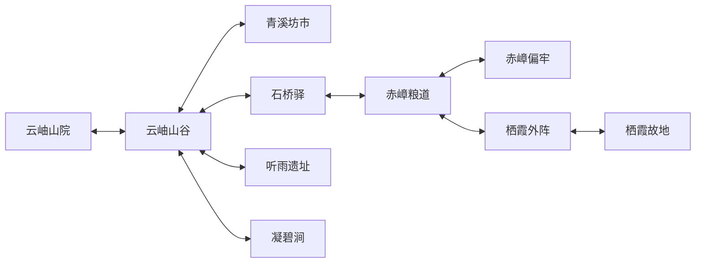

# 38 · 第一篇章世界与复仇剧情

> **暂存草案（2026-10-12）：** 用户认为当前跨到完整复仇篇章的步幅过大，要求先考虑尚未完成的系统与场景。本稿作为远期参考保留，暂缓扩写与实施；章节、地图、人物配置、数值和开发批次尚未整体确认。当前工作应先收束可实际游玩的局部流程，具体下一批另行确定。本稿没有对应的新游戏实现或完整验收。

2026-10-12 · U-121 用户边界 / R-40 作者内容草案。本文用于后续 Sol 细化与实施，新增章节、地方强度、场景内容和物件均为作者建议；现有代码只作为复用依据，本文不表示新首篇已实现或通过试玩。

关联 [14 前期详细设计](14-EARLY-GAME-DETAILED-DESIGN.md)、[04 世界剧情](04-WORLD-STORY.md)、[08 活世界](08-LIVING-WORLD.md)、[09 机遇与算计](09-INTRIGUE-OPPORTUNITIES.md)、[10 危机与生死](10-CRISES-RESCUE-DEATH.md)、[11 内容边界](11-AI-CONTENT-CONTRACT.md)、[12 作者真相卡](12-CONTENT-AUTHORING.md)、[39 门人与经营](39-FIRST-CAMPAIGN-DISCIPLES-ECONOMY.md)、[40 修行与斗法](40-FIRST-CAMPAIGN-CULTIVATION-COMBAT.md)。实现和验收查 [STATUS](STATUS.md) 与 [SR 台账](../requirements/registry.json)。

## 1. 首篇承诺与来源

- **U-121 边界：**建档至复仇成功构成完整第一篇章；掌门最高金丹初期，以准备和实际斗法挑战金丹中期仇敌。
- **U-121 人物：**随机安排不同天赋的求道者；同时在籍至多十五名门人，掌门另计，死亡或离宗后可补招。通关取决于具体能力与准备，收满十五人不是章节条件。
- **共同契约：**玩家只控掌门，出行沿用最多两名自愿同伴；所有人、物资、消息、旅行和战斗共享身份、空间、世界时钟，关闭不推进。
- **R-40 结构：**八章 C0–C7，十个本地实景，有限三责任人；章节显示已发生事实与下一可行行动，容许经营、调查、成长和支线交错。
- **R-40 新档开局：**沈氏遗孤沿 U-117 进入云岫山院临时落脚处，伤愈后营造主殿，母亲单卷传承沿 U-115/32 的五种出身选择结算。
- 已核实的旧基线：`14:64–86` 固定三责任链与结局；`dist/ea-sr-story.mjs:7–11` 使用三名稳定人物；`dist/ea-sr-world.mjs:12–20` 定义九个本地场景。
- 已核实的改动接缝：旧金丹来源在晟安，研读远洲图要求先完成复仇（`dist/ea-sr-world.mjs:206`；世界 SR 设计第 6、6.1 节）。本稿把首篇所需资源放入本地双路，晟安接续篇章后的远行。

## 2. 旧案真相、责任与地方强度

### 2.1 固定责任人

| 稳定人物 ID | R-40 新档境界 | 确定的责任事实 | 主要位置与最终事实 |
| --- | --- | --- | --- |
| `person:han-lichuan` 韩厉川 | 金丹中期 | 主导赤嶂门夺取沈氏灵脉产业并灭门，实际占据栖霞 | `scene:qixia`；实际战败身死，掌门取得可靠死亡消息 |
| `person:xing-lie` 邢烈 | 筑基后期 | 事前知情，调配本管事可支配的援手，约定分利 | `scene:ward` 为初始驻地，行动后沿实际位置追查；死亡事实核实 |
| `person:shao-heng` 邵衡 | 筑基中期 | 明知夺产，仍接收、转卖所得并隐匿分账 | `scene:supply` 为初始活动点，货运期间沿实际行程定位；死亡事实核实 |

三人的责任与姓名沿 R-26，韩的新境界是 R-40 作者默认。主角开局已知韩是直接仇敌，邢、邵由可靠调查获知；作者表与玩家知情视图分别保存。伏煞其余高层、承霄事后争利中层保留各自行为和成本，不追加为本篇必须清算对象。

### 2.2 地方势力的作者调整

| 势力 | 建议强度与约束 | 首篇可见作用 |
| --- | --- | --- |
| 承霄剑宗 | 地方主要正道金丹宗门；掌门建议金丹后期，基层按既有身份 | 坊市秩序、飞剑维护、商路护送；魏青书承办具体交涉 |
| 伏煞刀宗 | 地方主要魔道金丹宗门；掌门建议金丹后期，管事有独立预算 | 与赤嶂有贡契和商路利益；段谨可谈本堂中立，权限有限 |
| 赤嶂门 | 韩为金丹中期首领，其余已有成员按真实境界与供给 | 依赖伏煞的贡契、贸易保护和外部供给；独立重刀传承保持 |
| 百机山、玄阴谷、青溪顾氏、州府 | 沿现有地方组织与公开联系人，不为抬高终战集体升境 | 零件、安息旧约、药材、商路与税务服务，各有有限存货 |

这将旧文“一正一魔两家金丹宗门”的描述调整为“两家地方主导宗门与一名依附势力的金丹首领”，须随 R-40 同步 04、14 及新档作者卡。政治依附来自组织、通路与物资关系，首领同属金丹仍可成立。
灭门时韩已是金丹中期，真实境界在新档创建时固定；双亲仍为既定筑基阵师与丹师。父亲以预置护阵封窄追路，母亲以早备遁符护送，争得短暂逃生窗口；二人牺牲维持。此段需要画面与记录交代时间、路线及消耗，不能把逃生写成击败高境敌人。
韩开局只怀疑有遗孤逃脱，对云岫山院位置仍未知。后续暴露由商路目击、冲突和消息传播产生；敌方应对使用实际知情、有限人手与行程，不能读取玩家尚未公开的修为和住址。

## 3. 八章事实结构

章节名和 `campaign:first:C0` 至 `C7` 为建议展示键，实施时与既有 `story.step`、事实表映射；每章保存开启、已知目标、进行中行动和完成事实。准备数量、门人数和声望不充当通行证。

### C0 · 雨夜余烬

- **起点／先决：**新档、固定家史与遗物已登记；掌门炼气六层带伤进入临时落脚处。
- **行动：**调息与用药、检查母亲包裹、完成单卷传承选择；认识身体、私人物品和世界时钟。
- **完成／后果：**伤势达到可外出条件，传承选择落入真实人物与物品记录；主殿营造入口可用。
- **替代／失败：**暂缓开卷保留包裹；恢复路线先提供可达药材与调息，不能要求先学未选法门；退出、重载继续原阶段。

### C1 · 云岫立山

- **先决：**掌门可行动，山谷路径已知；营造仍检查实际物资、合法地块与劳动。
- **行动：**营造主殿，建立首田和食药补给，接触山门求见；陆知微可协商帮种，首个正式门人来自随机求道者。
- **完成／后果：**主殿真实完工，取得一次真实收成并形成可持续补给路径；个人与宗门公库用途可辨。
- **替代／失败：**陆知微拒绝、离开或未遇见时，掌门自学首田并亲作；门人拒绝工作时可改工、亲作或委托，章末不要求特定门人。

### C2 · 青溪旧账

- **先决：**可由山谷出入青溪，携带合理往返补给；可早于 C1 完工先探索。
- **行动：**查账房与货栈，获知邵衡的经手事实和粮道位置；接触筑基委托、自制丹方及当前主修续篇来源。
- **完成／后果：**至少有一条已知且可执行的筑基知识、材料路径；邵的责任主张、来源与地点消息分别登记。
- **替代／失败：**账册损坏用交易对手记录和货印核查；货栈无人可等营业或查留存登记。来源费用可用实际生产、护送或采购委托支付。

### C3 · 石桥听雨

- **先决：**石桥、听雨的具体线索已知；桥坏时可修复或绕行，地点风险在出发前说明。
- **行动：**接触程问舟的救治／装备合作，查雇佣单与匠具；赴听雨校勘父亲手札，识别邢烈与栖霞外阵结构，完成自己的筑基成长。
- **完成／后果：**邢的责任与活动位置有可靠来源；掌门可形成真实装备、法门、阵图中的可用准备。
- **替代／失败：**阵匠身死仍有旧单、工具刻记与独立见闻；旧卷毁损有合法拓本。拒绝装备支线可采用可靠交易／自制来源。

### C4 · 截流断账

- **先决：**邵的责任与所在路线已知；掌门自行判断战力，进入与挑战依实际路况和位置。
- **行动：**到粮道截获邵衡并战斗清算；可协商运粮人退路、进入偏牢救陆怀生、在坊市争取护送者中立。
- **完成／后果：**邵实际身死并核实；已实施准备改变敌方库存、护卫、情报和出行条件，各自单独记录。
- **替代／失败：**邵已换驻点则追查真实行程，败退保留其现状；陆怀生已死改查排班和旧雇佣单。营救与截粮均可放弃并承担相应战斗条件。

### C5 · 凝丹有期

- **先决：**筑基积累达到相应条件，已知可支持金丹的主修取得路径与一种凝丹髓来源；可与 C4 并行准备。
- **行动：**按 40 取得可用续篇或合法转修；完成青溪定额采购或凝碧涧实采，将凝丹髓带回合格练位，按真实身况完成凝丹。
- **完成／后果：**掌门成为金丹初期；供给、练位、疗养与器物准备可支撑一次有退路的远行。
- **替代／失败：**采购断路可修路续运或改走实采；实采受阻可采购。突破中断按 40 保存预留、已炼化消耗和调息恢复条件。

### C6 · 归乡破阵

- **先决：**外阵位置与邢的责任已知； C5 给出推荐准备目标，进入外阵本身由道路与危险决定。
- **行动：**查验驻棚、与实际在场的邢烈交战；按已学阵图解除可触及阵眼、辨认韩的蓄势与场地威胁，建立撤退路。
- **完成／后果：**邢死亡核实，栖霞进退路线明确；阵眼、驻兵和护持状态保存，离场再来按真实维护行动变化。
- **替代／失败：**缺阵术可委托阵匠制破阵器后由掌门实地操作，或按高风险正面方案进入；敌人离开须按有限消息追踪，不能复制一名站岗替身。

### C7 · 栖霞了愿

- **先决：**韩所在已知且实际可达；玩家自行发起挑战，40 提供金丹初期配合准备的正常攻略方案。
- **行动：**在真实场地击败金丹中期韩，收取双亲遗物并祭扫；核对三责任人结算，明确选择故地重建或回云岫续传。
- **完成／后果：**三人核实死亡、遗物取得、结局选择一起形成唯一完成记录；世间关系和宗门继续，财物仍需实际从遗产箱领取。
- **替代／失败：**战败可撤退、救治、整备后再来；先杀韩而邢／邵未结算时显示其具体待办。三人他因死亡可由可靠消息核实，结果不因打开结局页重发。

## 4. 十个实景与路线

前期七类地点沿 14 的用途展开为九个已有场景，再加入凝碧涧，共 **10 个实景**。牢、粮道与栖霞外阵各有独立地点；丹髓委托、可靠续篇及合法转修载体复用青溪货栈，不额外增加城市场景。

旧路沿现有 `route:home-valley`、`valley-market`、`bridge`／`detour`、`valley-ruins`、`quarry-supply`、`supply-prison`、`supply-ward`、`ward-qixia`；新增建议 `route:valley-ningbi`。所有边双向检查当前路况、旅费、携粮、人物体况与消息日期；原路返回仍花实际行程。场景的可达、已知、已安全探索为不同事实。

### S01 · 云岫山院｜`scene:yunxiu-courtyard`

- **入口出口／职责：**山门接山谷；掌门、随机门人与获准停留的访客在实际住处和工位生活，陆知微按约帮种。
- **交互／遭遇：**临时落脚处、母亲包裹、主殿地块、首田、工料缓存、出行集合点；发生求见、生产、伤病与回山整备。
- **持久变化：**营造阶段、作物、库存、门籍、床位、修行与伤势；离院人员保留同行或出行位置。
- **资产：**沿 U-117 山院分层地景、篷屋、主殿施工／完工、田地各阶段；山门迎送与集合脚点，人物实际工作和走路动作。

### S02 · 云岫山谷｜`scene:valley`

- **入口出口／职责：**山院、青溪、石桥、听雨、凝碧五个路口；守地人说明公路与私人采集权，遇见的求道者进入持久人物表。
- **交互／遭遇：**溪边药丛、石桥与旧路、听雨侧洞、旧采石支路碑；采集、辨踪、失联药师与短程避险教学。
- **持久变化：**药丛供给、桥况、雨后水位、已修路线和救援结果；侧洞复用本景地形内区。
- **资产：**林谷道路、溪流、桥完好／损坏／修好、药丛阶段、洞口、五个可见出口及告示点；雨雾影响须有可读通路。

### S03 · 青溪坊市｜`scene:market`

- **入口出口／职责：**外埠口回山谷；顾婉仪管药材和丹髓委托，魏青书管护送，罗铭管零件，周安管道路事务，各自按权限行动。
- **交互／遭遇：**旧商号账房、顾氏药铺、货栈与托运簿、地方告示；筑基交易、异地传承载体查验、委托结算与随机求道者接触共用街巷。
- **持久变化：**真实存货、订货、抵达货物、修复路况、护送承诺和已阅线索；暂离商人保持身份及日程。
- **资产：**坊门、街道、封闭铺面外观、货位、告示、泊车处、营业／闭铺标识；委托货箱具备领取前后状态。

### S04 · 石桥驿｜`scene:quarry`

- **入口出口／职责：**桥路／绕路回山谷，货道通粮道；程问舟保留伤匠及装备合作职责，段谨只代表本堂约定。
- **交互／遭遇：**阵匠歇脚屋、旧雇佣单与匠具、运货路碑；救治、器物修补、雇佣核查和有限中立交涉。
- **持久变化：**匠人身况、是否合作、交付工单、器物实例和留存记录；救治不自动入宗。
- **资产：**驿站外院、封闭歇脚屋、露天修具桌、旧路碑、行商停驻位；受伤／恢复人物动作和实际维修物件。

### S05 · 听雨遗址｜`scene:ruins`

- **入口出口／职责：**古径返回山谷；阴书履行自愿亡魂安息旧约，向掌门提供有成本的公开合作。
- **交互／遭遇：**护阵拓刻、父亲手札藏处、灵泉浅滩、安息碑；校勘、恢复残阵、采样和可绕避的失稳区域。
- **持久变化：**取走原物、合法拓本、修复节点、泉脉可用量；遗址不随重进刷新文物。
- **资产：**残墙、林间碑阵、浅滩、书匣藏位、阵纹平静／失稳／修复层；物件脚点与危险范围共用几何。

### S06 · 赤嶂粮道｜`scene:supply`

- **入口出口／职责：**西回石桥，支路到偏牢，东至外阵；邵衡经手财物，赵衡川代表运粮人生计，路人是否有责按事实区分。
- **交互／遭遇：**邵衡转卖货栈、工钱账、运粮会面处和车队；追踪、交涉退路、截获邵与实际护卫战斗。
- **持久变化：**邵的位置／生死、粮食转移、工人去向、护卫数量和道路控制；库存减少必须对应取走或消耗。
- **资产：**山道、货栈外观、车队、路障、集结空地、卸货箱和岔路；车货及尸体状态保持可辨。

### S07 · 赤嶂偏牢｜`scene:prison`

- **入口出口／职责：**唯一山道接粮道，牢内进退通路可侦察；陆怀生为旧案知情者，看守有轮岗与具体权限。
- **交互／遭遇：**门楼、排班簿、外院交接处和逃生窄道；可赎救或按已制定战斗办法营救，预先说明时间与危险。
- **持久变化：**被囚／获救／转移／死亡、支付物资、看守伤亡与警戒；死亡后原证言入口转向留存记载。
- **资产：**完整牢舍外观、院墙、可见门禁、交接位、窄道和岗哨；获救人物必须实际走到安全退路。

### S08 · 栖霞外阵｜`scene:ward`

- **入口出口／职责：**西退粮道，内门通故地；邢烈掌握当前援手和驻棚，守阵者执行实际轮守。
- **交互／遭遇：**护脉阵眼、外务驻棚、地脉裂隙、撤退口；侦察、实地破阵、挑战邢与避开金丹威压边缘。
- **持久变化：**阵眼完损、实际补修、驻军调动、邢的生死及已知消息；复访只执行已发生的维护。
- **资产：**山门外阵、节点连线、完整驻棚、掩体、阵眼三状态与通行标识；危险预警与真实伤害范围对应。

### S09 · 栖霞故地｜`scene:qixia`

- **入口出口／职责：**山门接外阵，场内回撤口保持可判断；韩据灵脉守核心产业，其知情与准备沿同一人物记录。
- **交互／遭遇：**旧山门、灵脉前庭、遗物石室、双亲碑前；金丹终战、遗物领取、祭扫、结束选择与遗产搬运。
- **持久变化：**韩实际死亡、战损、遗物归属、重建计划或回山纪念、遗产余量与故地产权记录。
- **资产：**旧宅封闭外观、战斗前庭、重刀威胁范围、石室入口与箱、双亲碑、战后痕迹；重建意向不立即生成成品建筑。

### S10 · 凝碧涧｜新建议 `scene:ningbi-ravine`

- **入口出口／职责：**沿山谷旧采石支路进出，同景划崖口、旧矿路、凝髓石脉三区；顾氏采务按公示采约办理许可，可到青溪登记。
- **交互／遭遇：**采约碑、泉脉测记、堵流石闸、凝髓石脉；调查产权、完成修渠约定、控制脉涌后持工具采得定额凝丹髓。
- **持久变化：**实际供给、已采批次、修闸进度、许可、旧矿路损坏与退路；凝丹髓只从登记矿藏移入行囊。
- **资产：**崖径、浅泉、露天石闸、侧洞口、矿脉完整／预留／采后、采约碑和安全立足点；风脉、泉脉与矿路观察记录对应实际地形。

所有实景须交付入口、路径、碰撞、遮挡、可选人物、物件占地与交互反馈。封闭建筑沿 U-101 保持完整外观，管理入口显示室内活动；资产表是制作清单，现有场景 ID 不代表该美术和完整操作已经验收。

## 5. 剧情人物与随机门人

| 人物／原身份 | 本篇职责及可见结果 | 入宗与替代 |
| --- | --- | --- |
| 陆知微 `person:lu-zhiwei` | 可信赠药结缘、短期照料或首田合作；是否暂居、帮种、同行各自协商 | 新档先保留外部合作身份；旧已入门者保持门籍，基本耕种可由掌门学习 |
| 程问舟 `person:cheng-wenzhou` | 伤匠救治、匠具见闻、可选装备修复和阵器委托 | 合作按本人意愿；主线线索有旧单与记录，装备有交易／自制来源 |
| 苏叶岚 `person:su-yelan` | 失联药师的定位、救援与危险教学，保持自身职业和关系 | 救援与入宗分开；线索与可靠成长不依赖其存活 |
| 陆怀生 `person:shen-witness` | 旧案见闻与韩蓄势习惯；获救改变终战预警知识 | 偏牢为可选准备，错过后仍可从实地观察和旧记录获知所需应对 |
| 顾婉仪、魏青书、罗铭、周安、段谨、阴书、赵衡川 | 对应药材、护送、器物、道路、中立、安息、工人退路的有限职责 | 固定服务渠道和登记可接续；死亡不换同名替身，未交付合同进入明确退款或承继结算 |
| 随机求道者 | 姓名、出身、天赋、志向、性格与技能形成独立持久人物 | 正式收录才占十五人名额；是否同意学习、工作及同行沿 39 |

表中未写出 `personId` 的已有角色须从存档人物注册表与源模块核对其现用 ID；实施不得按中文姓名另造一人。主线必须有掌门亲作、可靠委托或可学习知识的完成办法，特殊随机天赋仅改变策略、耗时与成本。

## 6. 关键物品、来源与交接

| 物品／信息载体 | 来源与作用 | 保存和失败处理 |
| --- | --- | --- |
| 母亲单卷、父亲手札与母亲药记 | 开局包裹／听雨原物；家史、所选传承及可靠后续线索 | 载体、已读知识与所有权分列，包裹选择一次保存 |
| 交易账、托运簿、货印、旧雇佣单、阵图拓本 | 青溪、石桥、听雨；分别核查邵、邢及阵眼结构 | 记录出处和独立性，原件损坏仍保留已取得合法副本与知识 |
| 筑基丹、续篇与转修卷本 | 按 40 的唯一名称、可修境界及来源表；交易、学习和突破分步发生 | 材料预留与载体归属保存，法门名字和篇章 ID 由 40 统一 |
| 凝丹髓 `material:condensed-core` | 青溪固定采购与凝碧涧实采两路，用于结丹 | 沿用既有定义 ID，来源和每份实例另记；本稿不复用晟安领取额度 |
| 破阵器、可靠武器／护具、退路补给 | 程问舟委托、坊市合法交易或实际制作 | 具体器物、耐久和库存；交付失败有工单、材料占用与恢复说明 |
| 父亲阵笔、母亲药匣、沈氏族谱 | 栖霞石室，沿已有叙事名称 | 绑定双亲遗物事实与实物实例；取一次，归属转移不撤销历史取得事实 |

丹髓双路均应保证掌门首次正常推进时有一份可落实的来源：采购先登记顾氏可履约的批次、对价和路程，实采先显示可采量、许可与恢复办法；不得在玩家未知时被无关模拟耗尽两路。自然补产、后续门人需求和费用节奏由 39/40 共同定额，有限库存不得被刷新界面补满。
青岚、寒泉的金丹续篇候选与赤阳／厚土／金锋的转修路径统一按 40：赤阳与厚土转 `Y-076`《地肺温元经》，金锋转 `Y-085`《玄磁回锋经》。原目录的炎荒地肺城炉师、玄朔剑师及磁井石函来源继续成立。
R-40 建议新增两条合法异地载体接触卡：青溪接收获地肺城炉师许可的分篇抄本，以及持明确取拓来历的磁井石函校本；各自保存授权者、原载体、托运与校验记录。当地到访授业可作另一访问方式，教师须实际理解所授篇章；详情由 40 与下表内容卡共同核定。
凝碧涧提供修行环境、实物和观察记录，可辅助已取得卷本的校读与练习；法门知识来源仍是可靠载体或授业。采购与实采各能配合本地可执行的续修／转修路径，原本取得、校读和实际修行各自结算。

## 7. 可直接细化的支线卡种子

以下新 `root:first:*:v1` 均为建议 ID，正式写入前按 12 补真相卡、时间图、对白和测试。触发时保存真相，调查显示有来源的线索；每卡的拒绝、迟到与死亡结果可继续主线。

| 根卡建议 ID／标题 | 作者真相与行动 | 线索／替代／持久后果 |
| --- | --- | --- |
| `root:first:lu-field:v1` 首田同行 | 陆知微真实需要药材与安置，协商一段帮种工作；正向合作 | 公开需求与实际药袋；可暂缓或亲作；好感、工时、收成各自结算 |
| `root:first:artisan:v1` 雨后匠火 | 程问舟带伤且有未完工契，救治后可履约；与旧案见闻相关 | 匠具与旧单互证；拒绝治疗不销毁纸证；伤势、工单与装备实例保持 |
| `root:first:herbalist:v1` 侧洞迟讯 | 苏叶岚因真实路况受困，近期目击提供有限救援窗口 | 脚印与药袋，不公开实时坐标；迟到有伤亡或自行脱困事实 |
| `root:first:core-order:v1` 青溪订髓 | 真货由合法有限货批抵达，顾氏需先完成护送／补给契约 | 货印与承运记录；断路可修复续运或结算退款转实采；货箱和订单守恒 |
| `root:first:ningbi:v1` 凝碧修渠 | 灵材真实，采约要求维护泉脉公共供水；属于产权义务暗线 | 采约碑与测记；可拒绝采约改采购；修渠效果及可采批次永久记录 |
| `root:first:difei-copy:v1` 炉师分篇 | 炎荒炉师确实授权相应分篇，青溪承接有偿抄本与校读；为新增传播经历 | 授权印与托运底册；商人暂离可查封存登记后预约领取，原件损坏按授权重抄；实际耗材、所有权和所学篇章保存 |
| `root:first:magnetic-copy:v1` 北来函拓 | 玄朔剑师一脉持合法磁井石函拓本，来历和金丹篇完整度可查；为新增传播经历 | 原函铭记与独立取拓记录；到访者离开可取其事先合法寄存载体，需真实校勘和练习；不能把拓本品质当成已掌握 |
| `root:first:workers:v1` 粮道归人 | 赵衡川要工钱和退路，交付后运粮人按真实路线撤离 | 工钱账与车队物资互证；拒绝后粮运继续；护卫、补给与工人位置改变 |

这些种子不代替已有母子篇根，也不按支线条数填算计比例。若与已有根同一因果链，实施应复用其根 ID 或登记迁移关系；须按 09 的重要独立根链口径审查作者暗线。

## 8. 收束、旧档与实施交接

- 收束条件沿三名固定责任人核实死亡、双亲遗物取得、明确结局选择；邢或邵先死、他因身死、韩先死等顺序都按同一事实汇总。
- 故地重建保存产权和分期工程意向，实际投入后逐步施工；回云岫续传保存祭扫、遗物安置和经营目标。两条均允许继续招人、耕种、学法与往来。
- 旧已完成复仇档保留原完成事实和奖励记录；旧人物的关系、已学、境界、装备、死亡与身份保持。新韩境界及新章节以显式内容版本迁移，不能直接覆写进行中的旧战斗。
- 下一批先落实 05 的状态／命令／保存对应：章节事实、来源知情、订单、物资预留、场景改动、敌人活动、消息核实及唯一结局；新建议 ID 在合并前核定。
- 制作顺序建议：C0–C2 山院／山谷／青溪正常链 → C3–C4 调查与筑基两战能力 → C5 双路结丹 → C6–C7 外阵与金丹终战，逐批真实画面操作及重载验证。
- 首篇验收应覆盖五种开局均可自然续修、随机低资质门人仍可通关、无人接受某项邀约的替代、采购和实采各一次、关键证人死亡替代、三战撤退与再战、两种结局及旧档保护。
- 待实施细化：场景实际米制布局与行程，凝碧供给／价格／再生周期，地方掌门强度的作者卡同步，具体对白，迁移版本，金丹战斗手感与自然经营所需时长；本文未提供这些项目的实机结论。

## 9. 核对依据

- `docs/design/14-EARLY-GAME-DETAILED-DESIGN.md:64–86、92–117、123`：固定三责任人、调查替代、收束、七类地点、成长与陆知微边界。
- `docs/design/04-WORLD-STORY.md:158–207`：父母境界与牺牲、直接夺产、现有阶段、有限责任和持续经营；`DECISIONS.md` 的 U-29–35、U-50–66、R-26 为来源等级。
- `dist/ea-sr-story.mjs:7–11、26、50–58`：稳定目标、陆怀生、同场挑战、核实死亡、遗物与结局；代码存在不等于新版本通过验收。
- `dist/ea-sr-world.mjs:12–20、32–40、52–58、206`：九个本地场景、路线、地方联系人与旧远洲条件；`dist/ea-sr-cultivation.mjs:21`：既有凝丹髓定义。
- [世界与责任链 SR 设计](../requirements/design/SR-XF-015-017-020-025-035-037-039.md)第 5–6.1 节及 [程问舟装备 SR 设计](../requirements/design/SR-XF-012-014-018-024-028-033.md) SR018：可复用准备动作、旧高境来源与装备合作。
